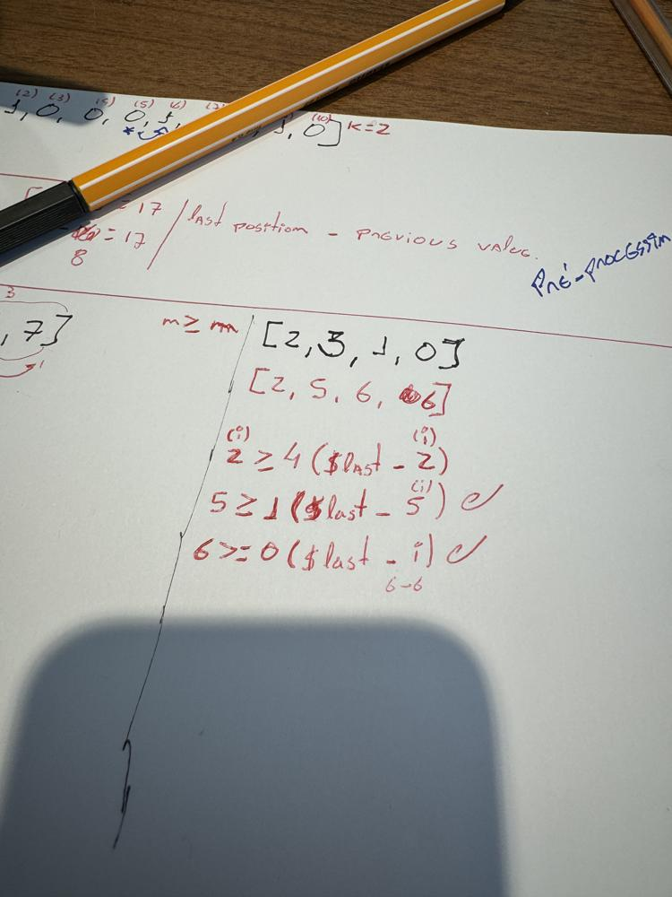

# 2270. Number of Ways to Split Array - TypeScript

**Author:** vitorbrangioni
**Votes:** 0
**Link:** [https://leetcode.com/problems/number-of-ways-to-split-array/solutions/5921350/](https://leetcode.com/problems/number-of-ways-to-split-array/solutions/5921350/)

---

# Intuition & Approach

If I create an array of sums (prefix sum), I can iterate on this array and compare with the sum of the rest of the array, which is the value of the last position minus the current value of the prefix sum. ($last - prefix[i]). Just compare these values, and if it's greater or equal than it, I can sum 1 in the result

Example:

`input`: [2, 3, 1, 0];
`prefixSum`: [2, 5, 6, 6] (sum of these values);

iterating on `prefixSum`:

## i=0 (first loop)
    2 (`prefixSum[0]`) >= 4 (`(6) prefixSum[lastPosition]` - `(2) prefixSum[1] = 4`);

## i=1 (second loop)
    5 (`prefixSum[1]`) >= 1 (`(6) prefixSum[lastPosition]` - `(5) prefixSum[1] = 1`);

## i=2 (third loop)
    6 (`prefixSum[2]`) >= 0 (`(6) prefixSum[lastPosition]` - `(6) prefixSum[1] = 0`);





# Complexity
- Time complexity: O(n)

- Space complexity: O(n)


# Code
```typescript []
function waysToSplitArray(nums: number[]): number {
    const prefixSum: number[] = [nums[0]];
    let result = 0;

    // 1. preparing prefix array - ok
    for(let i = 1; i < nums.length; i++) {
        prefixSum.push(nums[i] + prefixSum[i - 1]);
    }
    
    // 2. find possible subarrays 
    for(let i = 0; i < prefixSum.length - 1; i++) {
        const sumFirstArray = prefixSum[i]; 
        const sumOtherArray = prefixSum[prefixSum.length -1] - sumFirstArray;

        if (sumFirstArray >= sumOtherArray) {
            result += 1;
        }
    }
    return result;

};
```