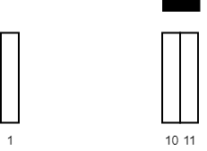

# [2271. Maximum White Tiles Covered by a Carpet](https://leetcode.com/problems/maximum-white-tiles-covered-by-a-carpet/)

| Category | Difficulty | Likes | Dislikes |
| :------: | :--------: | :---: | :------: |
| Algorithms | Medium | 829 | 57 |

**Tags:** [`array`](https://leetcode.com/tag/array), [`binary-search`](https://leetcode.com/tag/binary-search), [`greedy`](https://leetcode.com/tag/greedy), [`sliding-window`](https://leetcode.com/tag/sliding-window), [`sorting`](https://leetcode.com/tag/sorting), [`prefix-sum`](https://leetcode.com/tag/prefix-sum)

**Companies:** `google`

## Description

You are given a 2D integer array `tiles` where `tiles[i] = [l_i, r_i]` represents that every tile `j` in the range `l_i <= j <= r_i` is colored white.

You are also given an integer `carpetLen`, the length of a single carpet that can be placed **anywhere**.

Return *the **maximum** number of white tiles that can be covered by the carpet*.

 

**Example 1:**


```

Input: tiles = [[1,5],[10,11],[12,18],[20,25],[30,32]], carpetLen = 10
Output: 9
Explanation: Place the carpet starting on tile 10. 
It covers 9 white tiles, so we return 9.
Note that there may be other places where the carpet covers 9 white tiles.
It can be shown that the carpet cannot cover more than 9 white tiles.

```

**Example 2:**


```

Input: tiles = [[10,11],[1,1]], carpetLen = 2
Output: 2
Explanation: Place the carpet starting on tile 10. 
It covers 2 white tiles, so we return 2.

```

 

**Constraints:**

	- `1 <= tiles.length <= 5 * 10^4`

	- `tiles[i].length == 2`

	- `1 <= l_i <= r_i <= 10^9`

	- `1 <= carpetLen <= 10^9`

	- The `tiles` are **non-overlapping**.

---

**Links:** [Submissions](https://leetcode.com/problems/maximum-white-tiles-covered-by-a-carpet/) | [Solutions](https://leetcode.com/problems/maximum-white-tiles-covered-by-a-carpet/)
