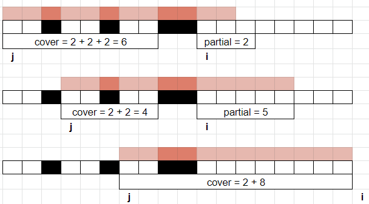

# Sliding Window

**Author:** votrubac
**Votes:** 219
**Link:** [https://leetcode.com/problems/maximum-white-tiles-covered-by-a-carpet/solutions/2038534/](https://leetcode.com/problems/maximum-white-tiles-covered-by-a-carpet/solutions/2038534/)

---

**Intuition:** it's always better to place a carpet at the beginning of a range. The reason is: if you shift a carpet one tile right, you *might* cover another white tile, but you definitely uncover the previous white tile.
 

So, we sort tile ranges, and check how many white tiles we can cover, starting from the beginning of each range.

To avoid TLE, we "drag" our carpet left-to-right, using the sliding window technique. It's a bit tricky for this problem:
1. We track the placement of the carpet in `j` (so the left side is `tiles[j][0]`).
2. When we can cover `tiles[i]`, we add those tiles to `cover` and extend the sliding window (`++i`).
3. Otherwise, we compute `partial` cover of `tiles[i]` (total cover is `cover + partial`).
	- We remove `tiles[j]` from `cover`.
	- We move the carpet to the next tile (`++j`), shrinking the sliding window.



**C++**
```cpp
int maximumWhiteTiles(vector<vector<int>>& t, int len) {
    int res = 0, j = 0, cover = 0;
    sort(begin(t), end(t));
    for (int i = 0; res < len && i < t.size(); )
        if (t[j][0] + len > t[i][1]) {
            cover += t[i][1] - t[i][0] + 1;
            res = max(res, cover);
            ++i;
        }
        else {
            int partial = max(0, t[j][0] + len - t[i][0]);
            res = max(res, cover + partial);
            cover -= (t[j][1] - t[j][0] + 1);
            ++j;
        }
    return res;
}
```