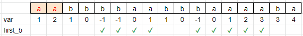

# Weird Kadane

**Author:** votrubac
**Votes:** 200
**Link:** [https://leetcode.com/problems/substring-with-largest-variance/solutions/2039178/](https://leetcode.com/problems/substring-with-largest-variance/solutions/2039178/)

---

We solve it independently for each combination of `2` characters. We use variables `a` and `b` below, and their values could be any character. We go left-to-right, and:
- For `a`, we increase our variance (`+1`).
- For `b` - decrease ( `-1`).
	- When the variance goes negative, we restart.

This is Kadane's algorithm. Hower, we need to make sure that the substring includes at least one `b` character. Therefore, we update the result only if  `has_b` is true.

Another trick is that we need to track whether our substring starts with `b`.  If we encounter another `b` - we can trim the first one (no change to the variance).

However, when the variance goes negative, the next substring will start with `b` again (`first_b = true`).

> The lowest the variance can go is `-1`. Thus, we would never have a situation when substring starts with more than one `b`.

This example demonstrates the running variance, and how `first_b` affects it for the "aabbbbaabbbaaaaba" test case:



**C++**
```cpp
int largestVariance(string s) {
    int res = 0;
    unordered_set<char> unique(begin(s), end(s));
    for (char a : unique)
        for (char b : unique) {
            int var = 0, has_b = 0, first_b = 0;
            for (auto ch : s) {
                var += ch == a;
                if (ch == b) {
                    has_b = true;
                    if (first_b && var >= 0)
                        first_b = false;
                    else if (--var < 0) {
                        first_b = true;
                        var = -1;
                    }
                }
                res = max(res, has_b ? var : 0);
            }
        }
    return res;
}
```