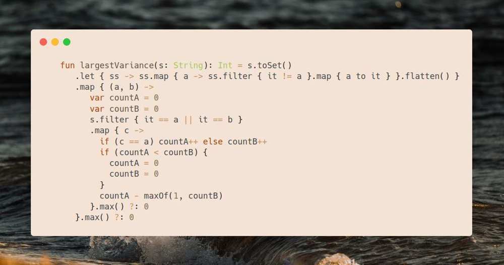

# Kotlin | try all pairs

**Author:** SamoylenkoDmitry
**Votes:** 1
**Link:** [https://leetcode.com/problems/substring-with-largest-variance/solutions/3739542/](https://leetcode.com/problems/substring-with-largest-variance/solutions/3739542/)

---



#### Join me on Telegram
https://t.me/leetcode_daily_unstoppable/270
#### Problem TLDR
Max diff between count `s[i]` and count `s[j]` in all substrings of `s`
#### Intuition
The first idea is to simplify the task by considering only two chars, iterating over all alphabet combinations.
Second idea is how to solve this problem for binary string in $$O(n)$$: `abaabbb` \u2192 `abbb`. 
We split this problem: find the largest subarray for `a` with the smallest count of `b`, and reverse the problem \u2013 largest `b` with smallest `a`.
For this issue, there is a Kadane's algorithm for maximizing `sum`: take values greedily and reset count when `sum < 0`.
Important customization is to always consider `countB` at least `1` as it must be present in a subarray.

#### Approach
* we can use `Set` of only the chars in `s`
* iterate in `ab` and `ba` pairs
* Kotlin API helps save some LOC
#### Complexity
- Time complexity:
$$O(n)$$
- Space complexity:
$$O(n)$$, or O(1) if `asSequence` used
#### Code
```

    fun largestVariance(s: String): Int = s.toSet()
       .let { ss -> ss.map { a -> ss.filter { it != a }.map { a to it } }.flatten() }
       .map { (a, b) -> 
          var countA = 0
          var countB = 0
          s.filter { it == a || it == b }
          .map { c ->
            if (c == a) countA++ else countB++
            if (countA < countB) {
              countA = 0
              countB = 0
            }
            countA - maxOf(1, countB)
          }.max() ?: 0
       }.max() ?: 0

```