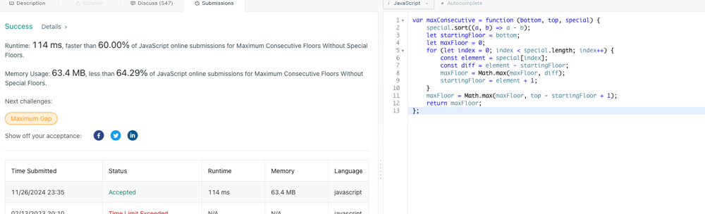

# ❇ tried-again-after-1.5-Years Images👌 🏆O(NLogN)❤️ Javascript🎯 Memory👀64%🕕 ++Explanation✍️🔴🔥✅

**Author:** anurag-sindhu
**Votes:** 2
**Link:** [https://leetcode.com/problems/maximum-consecutive-floors-without-special-floors/solutions/6086452/](https://leetcode.com/problems/maximum-consecutive-floors-without-special-floors/solutions/6086452/)

---

**Time Complexity: O(NLogN)\uD83D\uDD55
Space Complexity: O(1)**
```
var maxConsecutive = function (bottom, top, special) {
    special.sort((a, b) => a - b);
    let startingFloor = bottom;
    let maxFloor = 0;
    for (let index = 0; index < special.length; index++) {
        const consecutiveFloors = special[index] - startingFloor;
        maxFloor = Math.max(maxFloor, consecutiveFloors);
        startingFloor = special[index] + 1;
    }
    maxFloor = Math.max(maxFloor, top - startingFloor + 1);
    return maxFloor;
};
```


