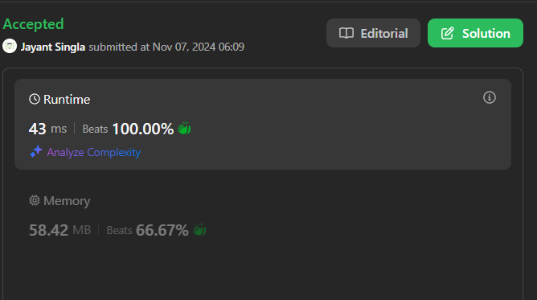

# Easiest Solution ✅✅ | Beats 100% | C++ | Java | Python3 | Javascript

**Author:** jay_singla
**Votes:** 191
**Link:** [https://leetcode.com/problems/largest-combination-with-bitwise-and-greater-than-zero/solutions/6017268/](https://leetcode.com/problems/largest-combination-with-bitwise-and-greater-than-zero/solutions/6017268/)

---



# Intuition

The problem asks us to find the largest combination of numbers in the list candidates whose AND is greater than 0 so if all the numbers in a combination has a ith bit set , it means their AND will surely be greater than 0 , so the problem breaks down to find the largest combination of numbers in the list candidates where a specific bit position (from 0 to 31) is set to 1. In other words, we want to find the maximum number of elements in candidates that share a common bit position set to 1.

# Approach
1) Initialize Variables:

- We start by defining a variable ans to store the maximum count of elements that share the same bit position with a bit set to 1.
2) Iterate Over Bit Positions:

- Since integers are 32 bits in length, we loop from 0 to 31 to cover all possible bit positions.
3) Count Set Bits for Each Position:

- For each bit position i (from 0 to 31), we count how many elements in candidates have that specific bit set to 1.
- To check if the i-th bit of a number candidate is set, we use the expression candidate & (1 << i).
  -  1 << i shifts 1 to the i-th bit position, creating a mask (like 00010000 for i = 4).
  -  candidate & (1 << i) checks if this bit is set by applying the mask; if the result is non-zero, then this bit is set in candidate.
4) Update Maximum Count:

- After counting the elements with the i-th bit set, we update ans to hold the maximum of ans and cnt.
5) Return the Result:

- After iterating over all bit positions, ans holds the largest combination of elements with a common set bit, which is returned as the answer.

# Complexity
- Time complexity:
O(n*32) where n is the size of candidates

- Space complexity:
O(1)

# Code
```javascript []
/**
 * @param {number[]} candidates
 * @return {number}
 */
var largestCombination = function(candidates) {
    let ans = 0;
        for (let i = 0; i < 32; i++) {
            let cnt = 0;
            for (const candidate of candidates) {
                if (candidate & (1 << i)) cnt++;
            }
            ans = Math.max(ans, cnt);
        }
        return ans;
};

```
```C++ []
class Solution {
public:
    int largestCombination(vector<int>& candidates) {
        int n = candidates.size(),ans = 0;
        for(int i=0;i<32;i++){
            int cnt = 0;
            for(auto candidate : candidates){
                if(candidate & (1<<i))cnt++;
            }
            ans = max(ans,cnt);
        }
        return ans;
    }
};
```
```java []
class Solution {
    public int largestCombination(int[] candidates) {
        int ans = 0;
        for (int i = 0; i < 32; i++) {
            int cnt = 0;
            for (int candidate : candidates) {
                if ((candidate & (1 << i)) != 0) cnt++;
            }
            ans = Math.max(ans, cnt);
        }
        return ans;
    }
}
```
```Python3 []
class Solution:
    def largestCombination(self, candidates: List[int]) -> int:
        ans = 0
        for i in range(32):
            cnt = sum(1 for candidate in candidates if candidate & (1 << i))
            ans = max(ans, cnt)
        return ans
```
