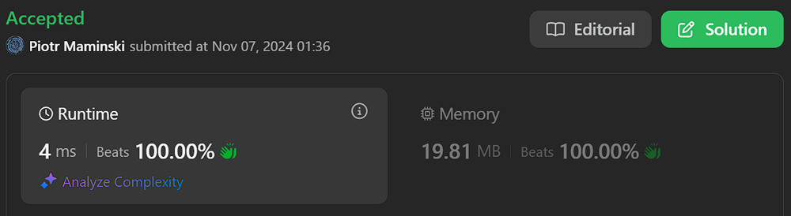

# ✅Beats 100% | Explained Step by Step | Most common Array Interview Problems✅

**Author:** Piotr_Maminski
**Votes:** 25
**Link:** [https://leetcode.com/problems/largest-combination-with-bitwise-and-greater-than-zero/solutions/6017206/](https://leetcode.com/problems/largest-combination-with-bitwise-and-greater-than-zero/solutions/6017206/)

---

# Aproach 1: Bit Count Array (Best in Java,C++)
100%: Java,Rust,Ruby,TS,JS,Swift,Go C++:93% C#: 57% Python: 36%

```python3 []
class Solution:
    def largestCombination(self, candidates: List[int]) -> int:
        # Create array to store count of 1's at each bit position (32 bits for integers)
        ans = [0] * 32
        
        # Iterate through each number in candidates array
        for x in candidates:
            self.find(x, ans)
        
        # Find the maximum count of 1's across all bit positions
        return max(ans)
    
    def find(self, n: int, ans: list) -> None:
        # Start from rightmost bit (31st position)
        j = 31
        
        # Continue until all bits are processed
        while n > 0:
            # Get the rightmost bit using bitwise AND with 1
            a = n & 1
            
            # Add the bit count to corresponding position in ans array
            ans[j] += a
            
            # Right shift n by 1 to process next bit
            n >>= 1
            
            # Move to next bit position from right to left
            j -= 1
```
```cpp []
class Solution {
public:
    // Main function that finds the largest combination of numbers from candidates
    // that have at least one common set bit (1) in their binary representation
    int largestCombination(vector<int>& candidates) {
        // Create vector to store count of 1's at each bit position (32 bits for integers)
        vector<int> ans(32, 0);
        
        // Iterate through each number in candidates vector
        for(int x : candidates) {
            // Count the number of 1's at each bit position for current number
            find(x, ans);
        }
        
        // Find the maximum count of 1's across all bit positions
        int res = 0;
        for(int i = 0; i < 32; i++) {
            res = max(res, ans[i]);
        }
        
        // Return the largest possible combination
        return res;
    }
    
    // Helper method to count number of 1's at each bit position
    // Parameters:
    // n - the number to analyze
    // ans - vector to store bit counts at each position
    void find(int n, vector<int>& ans) {
        // Start from rightmost bit (31st position)
        int j = 31;
        
        // Continue until all bits are processed
        while(n > 0) {
            // Get the rightmost bit using bitwise AND with 1
            int a = (n & 1);
            
            // Add the bit count to corresponding position in ans vector
            ans[j] += a;
            
            // Right shift n by 1 to process next bit
            n >>= 1;
            
            // Move to next bit position from right to left
            j--;
        }
    }
};
```
```java []
class Solution {
    // This method finds the largest combination of numbers from the candidates array
    // that have at least one common set bit (1) in their binary representation
    public int largestCombination(int[] candidates) {
        // Create array to store count of 1's at each bit position (32 bits for integers)
        int[] ans = new int[32];
        
        // Iterate through each number in candidates array
        for(int x : candidates) {
            // Count the number of 1's at each bit position for current number
            find(x, ans);
        }
        
        // Find the maximum count of 1's across all bit positions
        int res = 0;
        for(int i = 0; i < 32; i++) {
            res = Math.max(res, ans[i]);
        }
        
        // Return the largest possible combination
        return res;
    }
    
    // Helper method to count number of 1's at each bit position
    public void find(int n, int[] ans) {
        // Start from rightmost bit (31st position)
        int j = 31;
        
        // Continue until all bits are processed
        while(n > 0) {
            // Get the rightmost bit using bitwise AND with 1
            int a = (n & 1);
            
            // Add the bit count to corresponding position in ans array
            ans[j] += a;
            
            // Right shift n by 1 to process next bit
            n >>= 1;
            
            // Move to next bit position from right to left
            j--;
        }
    }
}
```
```csharp []
public class Solution {
    // This method finds the largest combination of numbers from the candidates array
    // that have at least one common set bit (1) in their binary representation
    public int LargestCombination(int[] candidates) {
        // Create array to store count of 1's at each bit position (32 bits for integers)
        int[] ans = new int[32];
        
        // Iterate through each number in candidates array
        foreach(int x in candidates) {
            // Count the number of 1's at each bit position for current number
            Find(x, ans);
        }
        
        // Find the maximum count of 1's across all bit positions
        int res = 0;
        for(int i = 0; i < 32; i++) {
            res = Math.Max(res, ans[i]);
        }
        
        // Return the largest possible combination
        return res;
    }
    
    // Helper method to count number of 1's at each bit position
    private void Find(int n, int[] ans) {
        // Start from rightmost bit (31st position)
        int j = 31;
        
        // Continue until all bits are processed
        while(n > 0) {
            // Get the rightmost bit using bitwise AND with 1
            int a = (n & 1);
            
            // Add the bit count to corresponding position in ans array
            ans[j] += a;
            
            // Right shift n by 1 to process next bit
            n >>= 1;
            
            // Move to next bit position from right to left
            j--;
        }
    }
}
```
```golang []
package solution

// largestCombination finds the largest combination of numbers from candidates
// that have at least one common set bit (1) in their binary representation
func largestCombination(candidates []int) int {
    // Create array to store count of 1's at each bit position (32 bits for integers)
    ans := make([]int, 32)
    
    // Iterate through each number in candidates slice
    for _, x := range candidates {
        // Count the number of 1's at each bit position for current number
        find(x, ans)
    }
    
    // Find the maximum count of 1's across all bit positions
    res := 0
    for i := 0; i < 32; i++ {
        if ans[i] > res {
            res = ans[i]
        }
    }
    
    return res
}

// find counts number of 1's at each bit position
// Parameters:
// n - the number to analyze
// ans - slice to store bit counts at each position
func find(n int, ans []int) {
    // Start from rightmost bit (31st position)
    j := 31
    
    // Continue until all bits are processed
    for n > 0 {
        // Get the rightmost bit using bitwise AND with 1
        a := n & 1
        
        // Add the bit count to corresponding position in ans slice
        ans[j] += a
        
        // Right shift n by 1 to process next bit
        n >>= 1
        
        // Move to next bit position from right to left
        j--
    }
}
```
```swift []
class Solution {
    // This method finds the largest combination of numbers from the candidates array
    // that have at least one common set bit (1) in their binary representation
    func largestCombination(_ candidates: [Int]) -> Int {
        // Create array to store count of 1's at each bit position (32 bits for integers)
        var ans = Array(repeating: 0, count: 32)
        
        // Iterate through each number in candidates array
        for x in candidates {
            // Count the number of 1's at each bit position for current number
            find(x, &ans)
        }
        
        // Find the maximum count of 1's across all bit positions
        return ans.max() ?? 0
    }
    
    // Helper method to count number of 1's at each bit position
    func find(_ n: Int, _ ans: inout [Int]) {
        // Start from rightmost bit (31st position)
        var j = 31
        var num = n
        
        // Continue until all bits are processed
        while num > 0 {
            // Get the rightmost bit using bitwise AND with 1
            let a = num & 1
            
            // Add the bit count to corresponding position in ans array
            ans[j] += a
            
            // Right shift n by 1 to process next bit
            num >>= 1
            
            // Move to next bit position from right to left
            j -= 1
        }
    }
}
```
```javascript [JS]
// JavaScript

/**
 * Finds the size of largest combination of numbers from candidates array where bitwise AND is greater than 0
 * @param {number[]} candidates - Array of positive integers
 * @return {number} - Size of the largest valid combination
 */
var largestCombination = function(candidates) {
    // Create array to store count of 1s at each bit position (32 bits)
    const ans = new Array(32).fill(0);
    
    // Process each number in candidates array
    for (let x of candidates) {
        find(x, ans);
    }
    
    // Find maximum count of 1s across all bit positions
    let res = 0;
    for (let i = 0; i < 32; i++) {
        res = Math.max(res, ans[i]);
    }
    
    return res;
};

/**
 * Helper function to count number of 1s at each bit position for a given number
 * @param {number} n - Number to analyze
 * @param {number[]} ans - Array to store count of 1s at each bit position
 */
function find(n, ans) {
    // Start from rightmost bit (31st position)
    let j = 31;
    
    // Process each bit until number becomes 0
    while (n > 0) {
        // Get rightmost bit using AND operation
        const a = n & 1;
        // Increment count at current position if bit is 1
        ans[j] += a;
        // Right shift to process next bit
        n >>= 1;
        j--;
    }
}
```
```typescript [TS]
// TypeScript

function largestCombination(candidates: number[]): number {
    // Create array to store count of 1's at each bit position (32 bits for integers)
    const ans: number[] = new Array(32).fill(0);
    
    // Iterate through each number in candidates array
    for (const x of candidates) {
        // Count the number of 1's at each bit position for current number
        find(x, ans);
    }
    
    // Find the maximum count of 1's across all bit positions
    let res = 0;
    for (let i = 0; i < 32; i++) {
        res = Math.max(res, ans[i]);
    }
    
    // Return the largest possible combination
    return res;
}

// Helper function to count number of 1's at each bit position
function find(n: number, ans: number[]): void {
    // Start from rightmost bit (31st position)
    let j = 31;
    
    // Continue until all bits are processed
    while (n > 0) {
        // Get the rightmost bit using bitwise AND with 1
        const a = n & 1;
        
        // Add the bit count to corresponding position in ans array
        ans[j] += a;
        
        // Right shift n by 1 to process next bit
        n >>= 1;
        
        // Move to next bit position from right to left
        j--;
    }
}
```
```rust []
impl Solution {
    pub fn largest_combination(candidates: Vec<i32>) -> i32 {
        let mut bit_counts = vec![0; 32];
        
        // Count bits for each number
        for &num in candidates.iter() {
            Self::count_bits(num, &mut bit_counts);
        }
        
        // Find maximum count
        *bit_counts.iter().max().unwrap()
    }
    
    fn count_bits(mut num: i32, bit_counts: &mut Vec<i32>) {
        for i in 0..32 {
            if (num & (1 << i)) != 0 {
                bit_counts[i] += 1;
            }
        }
    }
}
```
```ruby []
def largest_combination(candidates)
    # Create array to store count of 1's at each bit position
    ans = Array.new(32, 0)
    
    # Process each number in candidates array
    candidates.each do |x|
        find(x, ans)
    end
    
    # Find the maximum count of 1's across all bit positions
    ans.max
end

def find(n, ans)
    j = 31
    
    while n > 0
        # Get rightmost bit
        a = n & 1
        
        # Add bit count to corresponding position
        ans[j] += a
        
        # Right shift n by 1
        n >>= 1
        
        j -= 1
    end
end
```


## without comments
```python3 []
class Solution:
    def largestCombination(self, candidates: List[int]) -> int:
        ans = [0] * 32
        
        for x in candidates:
            self.find(x, ans)
        
        return max(ans)
    
    def find(self, n: int, ans: list) -> None:
        j = 31
        
        while n > 0:
            a = n & 1
            ans[j] += a
            n >>= 1
            j -= 1
```
```cpp []
class Solution {
public:
    int largestCombination(vector<int>& candidates) {
        vector<int> ans(32, 0);
        
        for(int x : candidates) {
            find(x, ans);
        }
        
        int res = 0;
        for(int i = 0; i < 32; i++) {
            res = max(res, ans[i]);
        }
        
        return res;
    }
    
    void find(int n, vector<int>& ans) {
        int j = 31;
        
        while(n > 0) {
            int a = (n & 1);
            ans[j] += a;
            n >>= 1;
            j--;
        }
    }
};
```
```java []
class Solution {
    public int largestCombination(int[] candidates) {
       int[] ans=new int[32];
       for(int x:candidates){
           find(x,ans);
       } 
        int res=0;
       for(int i=0;i<32;i++){
           res=Math.max(res,ans[i]);
       }
       return res;
    }
    public void find(int n,int[] ans){

        int j=31;
        while(n>0){
            int a=(n&1);
            ans[j]+=a;
            n>>=1;
            j--;
        }
    }
}
```
```csharp []
public class Solution {
    public int LargestCombination(int[] candidates) {
        int[] ans = new int[32];
        
        foreach(int x in candidates) {
            Find(x, ans);
        }
        
        int res = 0;
        for(int i = 0; i < 32; i++) {
            res = Math.Max(res, ans[i]);
        }
        
        return res;
    }
    
    private void Find(int n, int[] ans) {
        int j = 31;
        
        while(n > 0) {
            int a = (n & 1);
            ans[j] += a;
            n >>= 1;
            j--;
        }
    }
}
```
```golang []
package solution

func largestCombination(candidates []int) int {
    ans := make([]int, 32)
    
    for _, x := range candidates {
        find(x, ans)
    }
    
    res := 0
    for i := 0; i < 32; i++ {
        if ans[i] > res {
            res = ans[i]
        }
    }
    
    return res
}

func find(n int, ans []int) {
    j := 31
    
    for n > 0 {
        a := n & 1
        ans[j] += a
        n >>= 1
        j--
    }
}
```
```swift []
class Solution {
    func largestCombination(_ candidates: [Int]) -> Int {
        var ans = Array(repeating: 0, count: 32)
        
        for x in candidates {
            find(x, &ans)
        }
        
        return ans.max() ?? 0
    }
    
    func find(_ n: Int, _ ans: inout [Int]) {
        var j = 31
        var num = n
        
        while num > 0 {
            let a = num & 1
            ans[j] += a
            num >>= 1
            j -= 1
        }
    }
}
```
```javascript [JS]
// JavaScript

var largestCombination = function(candidates) {
    const ans = new Array(32).fill(0);
    
    for (let x of candidates) {
        find(x, ans);
    }
    
    let res = 0;
    for (let i = 0; i < 32; i++) {
        res = Math.max(res, ans[i]);
    }
    
    return res;
};

function find(n, ans) {
    let j = 31;
    
    while (n > 0) {
        const a = n & 1;
        ans[j] += a;
        n >>= 1;
        j--;
    }
}
```
```typescript [TS]
// TypeScript

function largestCombination(candidates: number[]): number {
    const ans: number[] = new Array(32).fill(0);
    
    for (const x of candidates) {
        find(x, ans);
    }
    
    let res = 0;
    for (let i = 0; i < 32; i++) {
        res = Math.max(res, ans[i]);
    }
    
    return res;
}

function find(n: number, ans: number[]): void {
    let j = 31;
    
    while (n > 0) {
        const a = n & 1;
        ans[j] += a;
        n >>= 1;
        j--;
    }
}
```
```rust []
impl Solution {
    pub fn largest_combination(candidates: Vec<i32>) -> i32 {
        let mut bit_counts = vec![0; 32];
        
        for &num in candidates.iter() {
            Self::count_bits(num, &mut bit_counts);
        }
        
        *bit_counts.iter().max().unwrap()
    }
    
    fn count_bits(mut num: i32, bit_counts: &mut Vec<i32>) {
        for i in 0..32 {
            if (num & (1 << i)) != 0 {
                bit_counts[i] += 1;
            }
        }
    }
}
```
```ruby []
def largest_combination(candidates)
    ans = Array.new(32, 0)
    
    candidates.each do |x|
        find(x, ans)
    end
    
    ans.max
end

def find(n, ans)
    j = 31
    
    while n > 0
        a = n & 1
        ans[j] += a
        n >>= 1
        j -= 1
    end
end
```
### Complexity: Time O(n * 32) = O(n) & Space O(1)


---


# Aproach 2: Direct Maximum Bit Count (Best in Python)
100%:Rust,Ruby,Typescript,JavaScript,Swift,Go Python:99% Java:96% C++:62% C#:14%
```python3 []
BitMax = 24
class Solution:
    def largestCombination(self, candidates: List[int]) -> int:
        max_set = 1
        mask = 1
        for shift in range(BitMax):
            count = 0
            for num in candidates:
                if num & mask:
                    count += 1
            if max_set < count:
                max_set = count
            mask <<= 1
        return max_set
```
```cpp []
class Solution {
public:
    int largestCombination(vector<int>& candidates) {
        const int BitMax = 24;
        int maxSet = 1;
        int mask = 1;
        
        for (int shift = 0; shift < BitMax; shift++) {
            int count = 0;
            for (int num : candidates) {
                if (num & mask) {
                    count++;
                }
            }
            maxSet = max(maxSet, count);
            mask <<= 1;
        }
        return maxSet;
    }
};
```
```java []
class Solution {
    public int largestCombination(int[] candidates) {
        final int BitMax = 24;
        int maxSet = 1;
        int mask = 1;
        
        for (int shift = 0; shift < BitMax; shift++) {
            int count = 0;
            
            for (int num : candidates) {
                if ((num & mask) != 0) {
                    count++;
                }
            }
            
            if (maxSet < count) {
                maxSet = count;
            }
            
            mask <<= 1;
        }
        
        return maxSet;
    }
}
```
```csharp []
public class Solution {
    private const int BitMax = 24;
    
    public int LargestCombination(int[] candidates) {
        int maxSet = 1;
        int mask = 1;
        
        for (int shift = 0; shift < BitMax; shift++) {
            int count = 0;
            foreach (int num in candidates) {
                if ((num & mask) != 0) {
                    count++;
                }
            }
            maxSet = Math.Max(maxSet, count);
            mask <<= 1;
        }
        return maxSet;
    }
}
```
```golang []
const BitMax = 24
func largestCombination(candidates []int) int {
    maxSet := 1
    mask := 1
    
    for shift := 0; shift < BitMax; shift++ {
        count := 0
        for _, num := range candidates {
            if num&mask != 0 {
                count++
            }
        }
        if maxSet < count {
            maxSet = count
        }
        mask <<= 1
    }
    return maxSet
}
```
```swift []
let BitMax = 24

class Solution {
    func largestCombination(_ candidates: [Int]) -> Int {
        var maxSet = 1
        var mask = 1
        
        for shift in 0..<BitMax {
            var count = 0
            for num in candidates {
                if (num & mask) != 0 {
                    count += 1
                }
            }
            if maxSet < count {
                maxSet = count
            }
            mask <<= 1
        }
        return maxSet
    }
}


```
```javascript [JS]
// JavaScript

var largestCombination = function(candidates) {
    const BitMax = 24;
    let maxSet = 1;
    let mask = 1;
    
    for (let shift = 0; shift < BitMax; shift++) {
        let count = 0;
        for (let num of candidates) {
            if (num & mask) {
                count++;
            }
        }
        maxSet = Math.max(maxSet, count);
        mask <<= 1;
    }
    
    return maxSet;
};
```
```typescript [TS]
// TypeScript

function largestCombination(candidates: number[]): number {
    const BitMax: number = 24;
    let maxSet: number = 1;
    let mask: number = 1;
    
    for (let shift = 0; shift < BitMax; shift++) {
        let count: number = 0;
        for (let num of candidates) {
            if (num & mask) {
                count++;
            }
        }
        maxSet = Math.max(maxSet, count);
        mask <<= 1;
    }
    
    return maxSet;
}
```
```rust []
const BIT_MAX: i32 = 24;

impl Solution {
    pub fn largest_combination(candidates: Vec<i32>) -> i32 {
        let mut max_set = 1;
        let mut mask = 1;
        
        for _shift in 0..BIT_MAX {
            let mut count = 0;
            for &num in candidates.iter() {
                if num & mask != 0 {
                    count += 1;
                }
            }
            if max_set < count {
                max_set = count;
            }
            mask <<= 1;
        }
        max_set
    }
}
```
```ruby []
def largest_combination(candidates)
    bit_max = 24
    max_set = 1
    mask = 1
    
    bit_max.times do |shift|
        count = 0
        
        candidates.each do |num|
            count += 1 if (num & mask) != 0
        end
        
        max_set = count if max_set < count
        mask <<= 1
    end
    
    max_set
end
```
### Complexity: Time O(N * BitMax [24]) & Space O(n) (Mostly O(1))

---


# Explanation

 

---
## Intuition 
The key insight is that when performing a bitwise AND operation between numbers, a '1' in the result can only occur when both numbers have '1' at the same bit position.

To maximize the AND result, we need to find the position where the most numbers have '1' bits in common.

```
7 (binary: 0111)
6 (binary: 0110)
5 (binary: 0101)
```


## Approach 1

1. Create a 32-bit counter array to track '1' bits at each position
2. For each number in candidates:
    - Convert it to binary and count '1's at each position
    - Store these counts in our counter array
3. The maximum value in our counter array represents the largest possible combination

 - Bitwise AND (&) to extract individual bits:
    - n & 1 gives us the rightmost bit
- Right shift (>>=) to process each bit:
    - n >>= 1 moves all bits one position right

```
Step 1: 0111 & 1 = 1
Step 2: 0011 & 1 = 1
Step 3: 0001 & 1 = 1
Step 4: 0000 & 1 = 0
```

## Aproach 2

BitMax = 24 because:

- The constraints mention numbers up to 10^7
- 2^24 = 16,777,216 which comfortably covers 10^7
- No need to check higher bits since they'll all be 0

Algorithm:

- Uses a sliding mask (starting at 1) to check each bit position
- For each bit position:
    - Counts how many numbers have a 1 in that position
    - Updates max_set if current count is larger
- Shifts mask left by 1 to check next bit position


[8,3,5]:

```
8 = 1000
3 = 0011
5 = 0101

Bit position counts:
Position 0: 1 (from 3,5)
Position 1: 2 (from 3)
Position 2: 1 (from 5)
Position 3: 1 (from 8)
```

Result: 2

---

# Still dont understand string/array/bit manipulation


**Video with IMO best explained:** google "Pointers in C / C++ [Full Course]"
 


# Most common Array Interview Problems
List based on my research (interviews, reddit, github) Probably not 100% accurate but very close to my recruitments. Leetcode Premium is probably more accurate [I don't have]


**Easy:** [[1. Two Sum]](https://leetcode.com/problems/two-sum/solutions/5999466/beats-100-explained-step-by-step-list-most-common-array-inverview) **(common warm-up)** [[121. Best Time to Buy and Sell Stock]](https://leetcode.com/problems/best-time-to-buy-and-sell-stock/description/?envType=problem-list-v2&envId=atbyk0mj) [[88. Merge Sorted Array]](https://leetcode.com/problems/merge-sorted-array/description/) [[27. Remove Element]](https://leetcode.com/problems/remove-element/description/) [[929. Unique Email Addresses]](https://leetcode.com/problems/unique-email-addresses/description/) [[482. License Key Formatting]](https://leetcode.com/problems/license-key-formatting/description/)


**Medium/Hard:** [[15. 3Sum]](https://leetcode.com/problems/3sum/description/) [[42. Trapping Rain Water]](https://leetcode.com/problems/trapping-rain-water/?envType=problem-list-v2&envId=atbyk0mj) [[56. Merge Intervals]](https://leetcode.com/problems/merge-intervals/description/) [[57. Insert Interval]](https://leetcode.com/problems/insert-interval/description/) [[46. Permutations]](https://leetcode.com/problems/permutations/description/) [[53. Maximum Subarray]](https://leetcode.com/problems/maximum-subarray/description/) [[73. Set Matrix Zeroes]](https://leetcode.com/problems/set-matrix-zeroes/description/) [[284. Peeking Iterator]](https://leetcode.com/problems/peeking-iterator/description/)


## Common Interview Question About Bit Manipulation:
- Swap two numbers without using a temporary variable 
(XOR understanding)
- Check if a number is a power of 2:
```
2^0 = 1 (binary: 1)
2^1 = 2 (binary: 10)
2^2 = 4 (binary: 100)
2^3 = 8 (binary: 1000)
```
- Find the single number in an array where every other number appears twice (XOR to delete pairs)


####  [Interview Questions and Answers Repository](https://github.com/RooTinfinite/Interview-questions-and-answers)


# Interview Priorities


| Patterns                | Difficulty | Interview Frequently           |
|----------------------|---------------------|----------------------|
| **Basic [Array](https://leetcode.com/problems/two-sum/solutions/5999466/beats-100-explained-step-by-step-list-most-common-array-inverview) / String**                 | **Easy**              | **Very High**               |
| **Two Pointers**         | **Easy**                | **High**                 |
| **Sliding Window**       | **Easy**                | **High**                 |
| **Breadth-First Search** | **Easy**                | **High**                 |
| **Depth-First Search**   | **Medium**              | **High**                 |
| **[Backtracking](https://leetcode.com/problems/letter-combinations-of-a-phone-number/solutions/5976064/complex-backtracking-interview-prepare-list-of-backtracking-questions-beats-100)**         | **High**                | **High**                 |
| Heap                 | Medium              | Medium               |
| Binary Search        | Easy                | Medium               |
| [Dynamic Programming](https://leetcode.com/problem-list/atwflvk7/)  | High                | Medium               |
| Divide and Conquer   | Medium              | Low                  |
| Trie                 | Medium              | Low                  |
| Union Find           | Medium              | Low                  |
| Greedy               | High                | Low                  |




