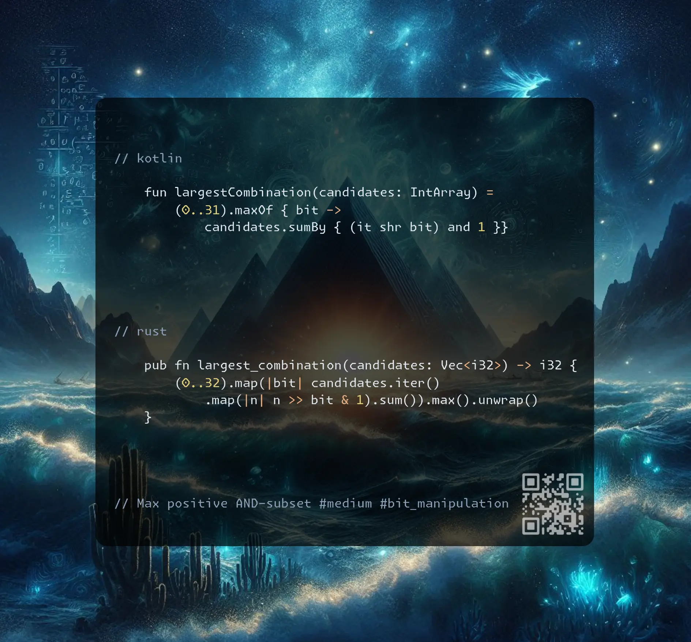

# Kotlin | Rust

**Author:** SamoylenkoDmitry
**Votes:** 3
**Link:** [https://leetcode.com/problems/largest-combination-with-bitwise-and-greater-than-zero/solutions/6018558/](https://leetcode.com/problems/largest-combination-with-bitwise-and-greater-than-zero/solutions/6018558/)

---



https://youtu.be/3UJslwuLjUQ

#### Join me on Telegram

https://t.me/leetcode_daily_unstoppable/793

#### Problem TLDR

Max positive AND-subset #medium #bit_manipulation

#### Intuition

Observe an example:

```j

    // 0001  1
    // 0010  2
    // 0011  3
    // 0100  4
    // 0101  5
    // 0110  6
    // 0111  7
    // 1000  8
    // 1444

```
Going vertically we see how on each column bits are cancelled with `AND` operation. Excluding zero-bits from each colum gives us subset with non-zero `AND`.

#### Approach

* count bits on each 32-bit interger position, choose max
* we can make outer loop shorter 0..31 and inner loop longer 

#### Complexity

- Time complexity:
$$O(n)$$

- Space complexity:
$$O(1)$$

#### Code

```kotlin []

    fun largestCombination(candidates: IntArray) =
        (0..31).maxOf { bit -> 
            candidates.sumBy { (it shr bit) and 1 }}

```
```rust []

    pub fn largest_combination(candidates: Vec<i32>) -> i32 {
        (0..32).map(|bit| candidates.iter()
            .map(|n| n >> bit & 1).sum()).max().unwrap()
    }

```
```c++ []

    int largestCombination(vector<int>& c) {
        int m = 0, b = 24, s;
        while (b--) for (s = 0; int n: c) 
            s += n >> b & 1, m = max(m, s);
        return m;
    }

```
```rust(optimized) []

    pub fn largest_combination(candidates: Vec<i32>) -> i32 {
        let mut r = [0; 32];
        for mut n in candidates {
            while n > 0 {
                r[n.trailing_zeros() as usize] += 1;
                n = n & (n - 1);
            }
        }
        *r.iter().max().unwrap()
    }

```