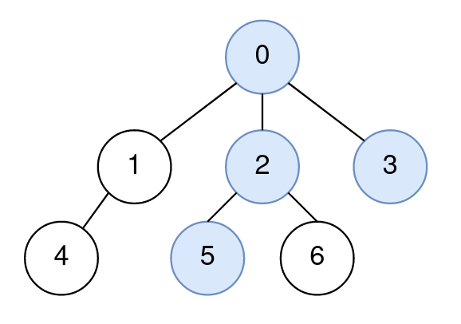
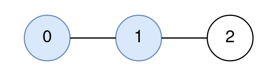
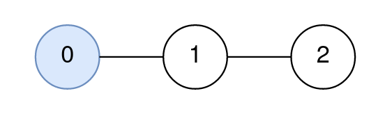

# [2277. Closest Node to Path in Tree](https://leetcode.com/problems/closest-node-to-path-in-tree/)

| Category | Difficulty | Likes | Dislikes |
| :------: | :--------: | :---: | :------: |
| Algorithms | Hard | 138 | 3 |

**Tags:** [`array`](https://leetcode.com/tag/array), [`tree`](https://leetcode.com/tag/tree), [`depth-first-search`](https://leetcode.com/tag/depth-first-search), [`breadth-first-search`](https://leetcode.com/tag/breadth-first-search)


## Description

You are given a positive integer `n` representing the number of nodes in a tree, numbered from `0` to `n - 1` (**inclusive**). You are also given a 2D integer array `edges` of length `n - 1`, where `edges[i] = [node1_i, node2_i]` denotes that there is a **bidirectional** edge connecting `node1_i` and `node2_i` in the tree.

You are given a **0-indexed** integer array `query` of length `m` where `query[i] = [start_i, end_i, node_i]` means that for the `i^th` query, you are tasked with finding the node on the path from `start_i` to `end_i` that is **closest** to `node_i`.

Return *an integer array *`answer`* of length *`m`*, where *`answer[i]`* is the answer to the *`i^th`* query*.

 

**Example 1:**


```

Input: n = 7, edges = [[0,1],[0,2],[0,3],[1,4],[2,5],[2,6]], query = [[5,3,4],[5,3,6]]
Output: [0,2]
Explanation:
The path from node 5 to node 3 consists of the nodes 5, 2, 0, and 3.
The distance between node 4 and node 0 is 2.
Node 0 is the node on the path closest to node 4, so the answer to the first query is 0.
The distance between node 6 and node 2 is 1.
Node 2 is the node on the path closest to node 6, so the answer to the second query is 2.

```

**Example 2:**


```

Input: n = 3, edges = [[0,1],[1,2]], query = [[0,1,2]]
Output: [1]
Explanation:
The path from node 0 to node 1 consists of the nodes 0, 1.
The distance between node 2 and node 1 is 1.
Node 1 is the node on the path closest to node 2, so the answer to the first query is 1.

```

**Example 3:**


```

Input: n = 3, edges = [[0,1],[1,2]], query = [[0,0,0]]
Output: [0]
Explanation:
The path from node 0 to node 0 consists of the node 0.
Since 0 is the only node on the path, the answer to the first query is 0.
```

 

**Constraints:**

	- `1 <= n <= 1000`

	- `edges.length == n - 1`

	- `edges[i].length == 2`

	- `0 <= node1_i, node2_i <= n - 1`

	- `node1_i != node2_i`

	- `1 <= query.length <= 1000`

	- `query[i].length == 3`

	- `0 <= start_i, end_i, node_i <= n - 1`

	- The graph is a tree.

---

**Links:** [Submissions](https://leetcode.com/problems/closest-node-to-path-in-tree/) | [Solutions](https://leetcode.com/problems/closest-node-to-path-in-tree/)
