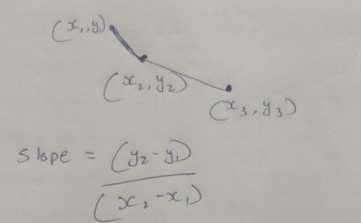
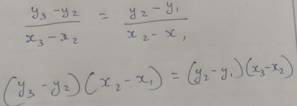

# Easy C++ Solution using math

**Author:** NeerajSati
**Votes:** 172
**Link:** [https://leetcode.com/problems/minimum-lines-to-represent-a-line-chart/solutions/2061910/](https://leetcode.com/problems/minimum-lines-to-represent-a-line-chart/solutions/2061910/)

---




**Now if we have to compare slopes of two different lines, we can do:**



```
class Solution {
public:
    int minimumLines(vector<vector<int>>& stk) {
        sort(stk.begin(),stk.end());
        int n = stk.size();
        if(n==1)
            return 0;
        int cnt = 1;
        for(int i=2;i<n;i++){
            long x1 = stk[i][0],x2 = stk[i-1][0],x3 = stk[i-2][0];
            long y1 = stk[i][1],y2 = stk[i-1][1],y3 = stk[i-2][1];
            long diff1 = (y3-y2) * (x2-x1);
            long diff2 = (y2-y1) * (x3-x2);
            if(diff1 != diff2)
                cnt++;
        }
        
        return cnt;
    }
};
```