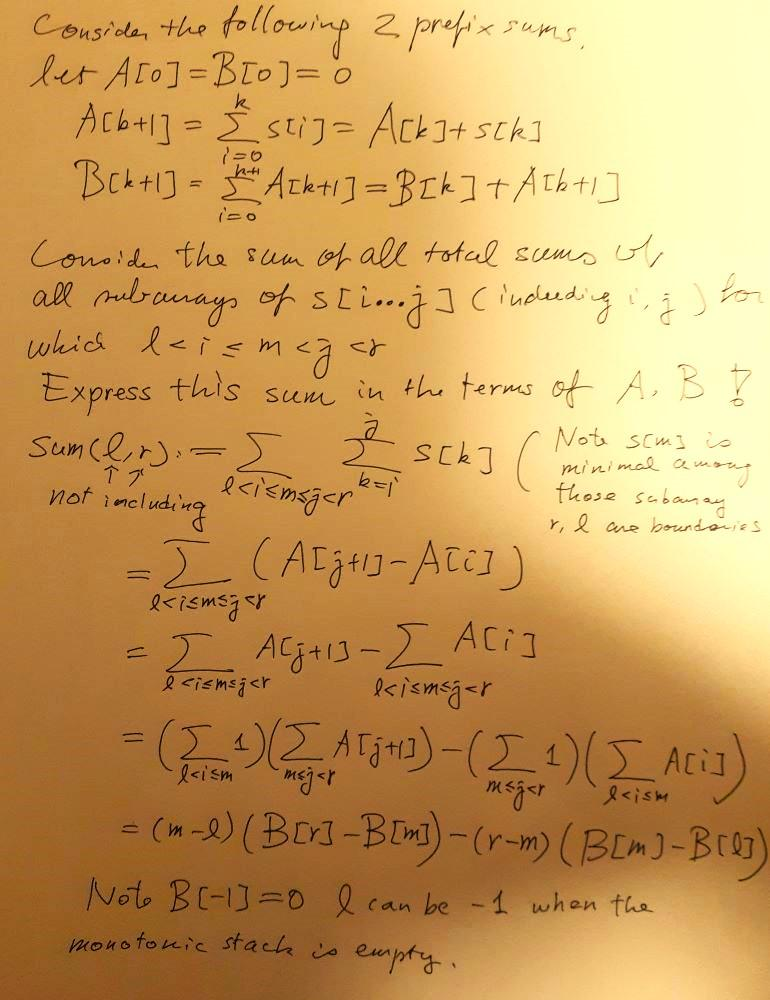

# C++Prefix sums&  monotonic stack with Math handwritten deductions||55ms beats 100%

**Author:** anwendeng
**Votes:** 5
**Link:** [https://leetcode.com/problems/sum-of-total-strength-of-wizards/solutions/4607133/](https://leetcode.com/problems/sum-of-total-strength-of-wizards/solutions/4607133/)

---

# Intuition
<!-- Describe your first thoughts on how to solve this problem. -->
It took me much time to finish this question solved, not just programming but also math.
# Approach
<!-- Describe your approach to solving the problem. -->


# Complexity
- Time complexity:
<!-- Add your time complexity here, e.g. $$O(n)$$ -->
$$O(n)$$
- Space complexity:
<!-- Add your space complexity here, e.g. $$O(n)$$ -->
$$O(n)$$
# Code 55ms beats 100%
```
#pragma GCC optimize("O3", "unroll-loops")
class Solution {
public:
    void print(auto& c){
        int sz=c.size();
        cout<<"[";
        for(int i=0; i<sz-1; i++) cout<<c[i]<<", ";
        cout<<c[sz-1]<<"]\
";
    }
    int totalStrength(vector<int>& s) {
        int n=s.size(), mod=1e9+7;

        //Use these 2 prefix sums A, B to find sum of sums for subarrays
        vector<long long> A(n+1, 0LL), B(n+1, 0LL);
        for(int i=0; i<n; i++){
            A[i+1]=(A[i]+s[i])%mod;
            B[i+1]=(B[i]+A[i+1])%mod;
        }
    //    print(A); print(B);

        vector<int> stack;
        long long ans=0;
        for(int r=0; r<=n; r++){
            //monotonic increasing stack storing the index
            while(!stack.empty() && (r==n||s[r]<=s[stack.back()]))
            {
                int m=stack.back();
                stack.pop_back();
                int l=stack.empty()?-1:stack.back();
                
                long long sum =(2*mod+(m-l)*(B[r]-B[m])%mod-(r-m)*(B[m]-B[max(l, 0)])%mod);
                ans = (ans+sum*s[m]) % mod;
            }
            stack.push_back(r);
        }
        return ans;
    }
};

auto init = []()
{ 
    ios::sync_with_stdio(0);
    cin.tie(0);
    cout.tie(0);
    return 'c';
}();
```