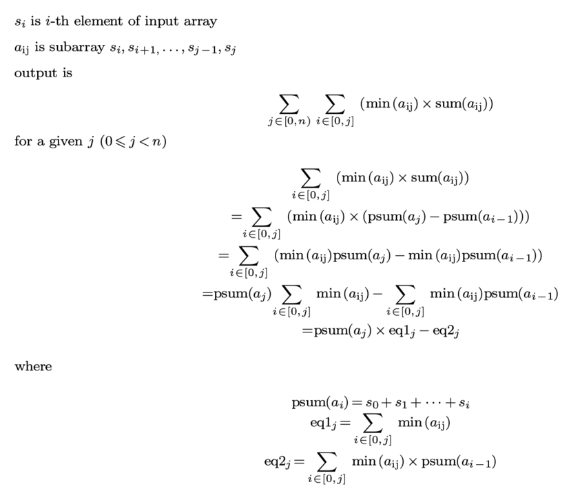
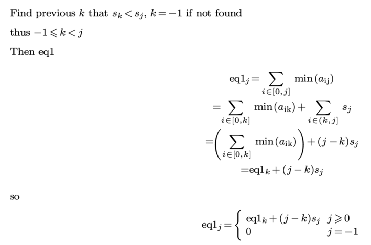
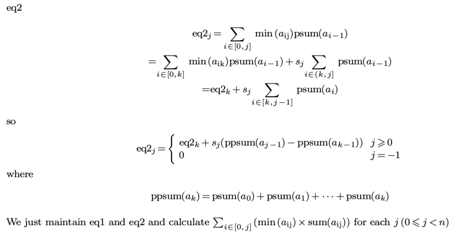

# Racket solution and explanation

**Author:** 6cdh
**Votes:** 0
**Link:** [https://leetcode.com/problems/sum-of-total-strength-of-wizards/solutions/2076924/](https://leetcode.com/problems/sum-of-total-strength-of-wizards/solutions/2076924/)

---

Explanation





Racket code

```scheme
(define/contract (total-strength strength)
  (-> (listof exact-integer?) exact-integer?)

  (define len (length strength))

  (define prev-smaller-lst
    (let ([stk '()]
          [get-strength (lst-ith strength #f)])
      (for/list ([i len]
                 [v strength])
        (let ([remain (dropf stk (lambda (j) (>= (get-strength j) v)))])
          (set! stk (cons i remain))
          (if (null? remain)
              -1
              (car remain))))))

  (let* ([psum (get-prefixsum strength)]
         [fpsum (lst-ith psum 0)]
         [ppsum (get-prefixsum psum)]
         [fppsum (lst-ith ppsum 0)]
         [eq1s (make-vector len)]
         [eq2s (make-vector len)]
         [results
          (for/list ([i len]
                     [v strength]
                     [k prev-smaller-lst])
            (let ([eq1 (mod (+ (if (= k -1) 0 (vector-ref eq1s k))
                               (mod (* (- i k) v))))]
                  [eq2 (mod (+ (if (= k -1) 0 (vector-ref eq2s k))
                               (mod (* v (- (fppsum (- i 1))
                                            (fppsum (- k 1)))))))])
              (vector-set! eq1s i eq1)
              (vector-set! eq2s i eq2)
              (mod (- (mod (* (fpsum i) eq1)) eq2))))])
    (foldl (compose mod +) 0 results)))

(define (mod x) (modulo x (+ #e1e9 7)))

;; helpers ;;

(define (lst-ith lst default)
  (let ([vec (list->vector lst)])
    (lambda (i)
      (if (< i 0)
          default
          (vector-ref vec i)))))

(define (get-prefixsum lst)
  (scanl (compose mod +) 0 lst))

(define (scanl f init lst)
  (let ([acc init])
    (for/list ([v lst])
      (set! acc (f v acc))
      acc)))
```