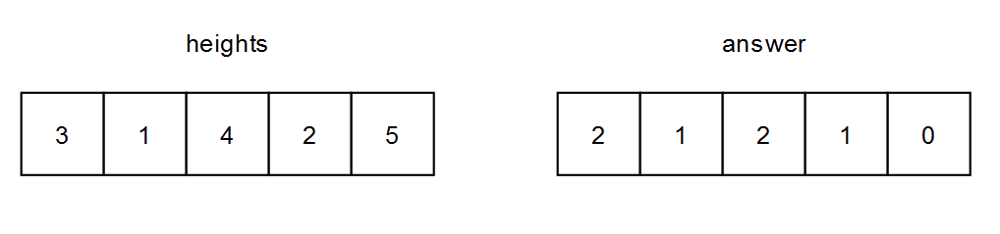
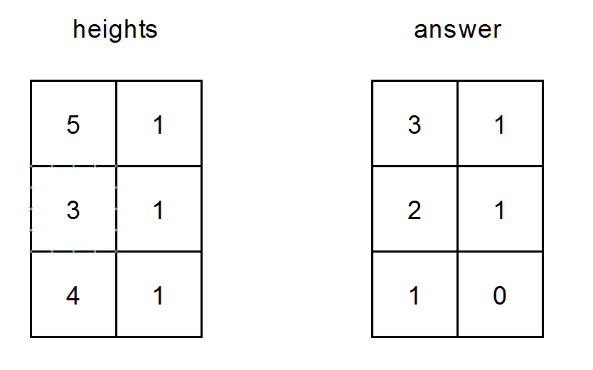

# [2282. Number of People That Can Be Seen in a Grid](https://leetcode.com/problems/number-of-people-that-can-be-seen-in-a-grid/)

| Category | Difficulty | Likes | Dislikes |
| :------: | :--------: | :---: | :------: |
| Algorithms | Medium | 66 | 34 |

**Tags:** [`array`](https://leetcode.com/tag/array), [`stack`](https://leetcode.com/tag/stack), [`matrix`](https://leetcode.com/tag/matrix), [`monotonic-stack`](https://leetcode.com/tag/monotonic-stack)

**Companies:** `uber`

## Description

You are given an `m x n` **0-indexed** 2D array of positive integers `heights` where `heights[i][j]` is the height of the person standing at position `(i, j)`.

A person standing at position `(row_1, col_1)` can see a person standing at position `(row_2, col_2)` if:

	- The person at `(row_2, col_2)` is to the right **or** below the person at `(row_1, col_1)`. More formally, this means that either `row_1 == row_2` and `col_1 < col_2` **or** `row_1 < row_2` and `col_1 == col_2`.

	- Everyone in between them is shorter than **both** of them.

Return* an *`m x n`* 2D array of integers *`answer`* where *`answer[i][j]`* is the number of people that the person at position *`(i, j)`* can see.*

 

**Example 1:**


```

Input: heights = [[3,1,4,2,5]]
Output: [[2,1,2,1,0]]
Explanation:
- The person at (0, 0) can see the people at (0, 1) and (0, 2).
  Note that he cannot see the person at (0, 4) because the person at (0, 2) is taller than him.
- The person at (0, 1) can see the person at (0, 2).
- The person at (0, 2) can see the people at (0, 3) and (0, 4).
- The person at (0, 3) can see the person at (0, 4).
- The person at (0, 4) cannot see anybody.

```

**Example 2:**


```

Input: heights = [[5,1],[3,1],[4,1]]
Output: [[3,1],[2,1],[1,0]]
Explanation:
- The person at (0, 0) can see the people at (0, 1), (1, 0) and (2, 0).
- The person at (0, 1) can see the person at (1, 1).
- The person at (1, 0) can see the people at (1, 1) and (2, 0).
- The person at (1, 1) can see the person at (2, 1).
- The person at (2, 0) can see the person at (2, 1).
- The person at (2, 1) cannot see anybody.

```

 

**Constraints:**

	- `1 <= heights.length <= 400`

	- `1 <= heights[i].length <= 400`

	- `1 <= heights[i][j] <= 10^5`

---

**Links:** [Submissions](https://leetcode.com/problems/number-of-people-that-can-be-seen-in-a-grid/) | [Solutions](https://leetcode.com/problems/number-of-people-that-can-be-seen-in-a-grid/)
