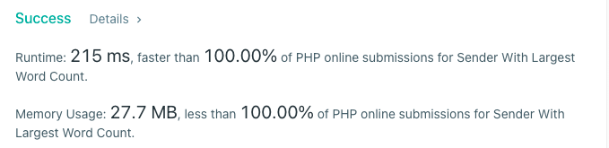

# PHP 100% mem & speed

**Author:** stuu
**Votes:** 0
**Link:** [https://leetcode.com/problems/sender-with-largest-word-count/solutions/2090896/](https://leetcode.com/problems/sender-with-largest-word-count/solutions/2090896/)

---


```
class Solution
{

  /**
   * @param String[] $messages
   * @param String[] $senders
   * @return String
   */
  function largestWordCount($messages, $senders)
  {
    $sender_counts = array_fill_keys($senders, 0);

    foreach ($messages as $sender_key => $message) {
      $sender_counts[$senders[$sender_key]] += str_word_count($message);
    }

    $top_senders = array_keys($sender_counts, max($sender_counts));
    natsort($top_senders);
    return end($top_senders);
  }
}
