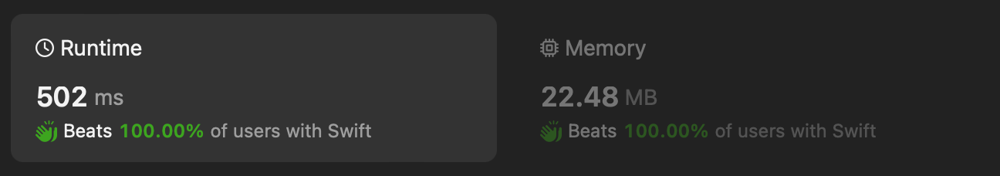

# ✅ Monotonic Stack Solution

**Author:** eleev
**Votes:** 1
**Link:** [https://leetcode.com/problems/steps-to-make-array-non-decreasing/solutions/4904492/](https://leetcode.com/problems/steps-to-make-array-non-decreasing/solutions/4904492/)

---



# Solution
```swift
final class Solution {
    @_optimize(speed)
    func totalSteps(_ nums: [Int]) -> Int {
        guard !nums.isEmpty else { return 0 }
        var steps = 0
        var dp = ContiguousArray(repeating: 0, count: nums.count)
        // monotonic stack
        var stack = ContiguousArray<Int>()
         // assuming the worst case scenario when all elements are equal or increasing
        stack.reserveCapacity(nums.count)
        
        // pops elements from the stack to compute the number of rounds it will take for it to be removed
        // ought to be used to compute the max number of rounds for all elements as the number of `steps`
        func rounds(for element: Int) -> Int {
            var rounds = 0
            while let last = stack.last, element > nums[last] {
                rounds = max(rounds + 1, dp[stack.removeLast()])
            }
            return rounds
        }

        for (i, e) in nums.enumerated().reversed() {
            let rounds = rounds(for: e)
            stack += [i]
            dp[i] = rounds
            steps = max(steps, rounds)
        }
        return steps
    }
}
```