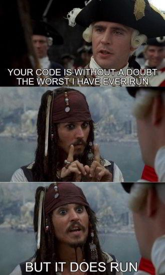

# ✔️ EXPLANATION || O ( N ) || PYTHON ||

**Author:** karan_8082
**Votes:** 18
**Link:** [https://leetcode.com/problems/min-max-game/solutions/2115014/](https://leetcode.com/problems/min-max-game/solutions/2115014/)

---

No need to create new array.
It can be seen that changes can be mae within same array.
The changed elements are never called again so their positions are useless and we use those vacant indexes.

```
class Solution:
    def minMaxGame(self, a: List[int]) -> int:
        
        def solve(n):
            if n==1:
                return
            for i in range(n//2):
                if i%2:
                    a[i] = max (a[2*i], a[2*i+1])
                else:
                    a[i] = min (a[2*i], a[2*i+1])
            solve(n//2)
            return
        solve(len(a))
        return a[0]
```

