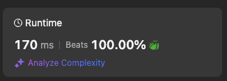

# Beats 100% 💅🏻 Greedy Algorithm

**Author:** stazcp
**Votes:** 0
**Link:** [https://leetcode.com/problems/partition-array-such-that-maximum-difference-is-k/solutions/5854059/](https://leetcode.com/problems/partition-array-such-that-maximum-difference-is-k/solutions/5854059/)

---



# Intuition
<!-- Describe your first thoughts on how to solve this problem. -->
I am going to use Greedy Algorithm to solve this.
# Approach
<!-- Describe your approach to solving the problem. -->
1. sort the array
2. to save space just keep track of last element and compare to next one if it is larger than k it should be on the next subarray so we increment the count and move max to the new largest number
3. finally return the count
// instead of Math.abs just do nums[i] - max since max will be always smaller than the next number.
# Complexity
- Time complexity:
<!-- Add your time complexity here, e.g. $$O(n)$$ -->
	1.	Sorting the Array:
	\u2022	Operation: nums.sort((a, b) => a - b)
	\u2022	Complexity: The sort method in JavaScript typically implements Timsort, which has a time complexity of O(n log n) in the average and worst cases.
	2.	Iterating Through the Sorted Array:
	\u2022	Operation: The for loop that traverses the array once.
	\u2022	Complexity: O(n)
	3.	Overall Time Complexity:
	\u2022	Combined Complexity: O(n log n) + O(n) \u2248 O(n log n)
	\u2022	Reasoning: The dominant term here is O(n log n) from the sorting step. Therefore, the overall time complexity is O(n log n).
- Space complexity:
<!-- Add your space complexity here, e.g. $$O(n)$$ -->
	1.	Sorting In-Place:
	\u2022	In JavaScript, the sort method sorts the array in-place, meaning it doesn\u2019t require additional space proportional to the input size.
	2.	Auxiliary Variables:
	\u2022	You use a few variables (max, count, and loop indices), which consume O(1) space.
	3.	Overall Space Complexity:
	\u2022	O(1) (constant space)

# Code
```typescript []
function partitionArray(nums: number[], k: number): number {
    const sorted = nums.sort((a, b) => a - b)
    let max = nums[0]
    let count = 1
    for (let i = 1; i < sorted.length; i++) {
        if(Math.abs(max - nums[i]) > k ){
            max = nums[i]
            count++
        }
    }

    return count
};
```