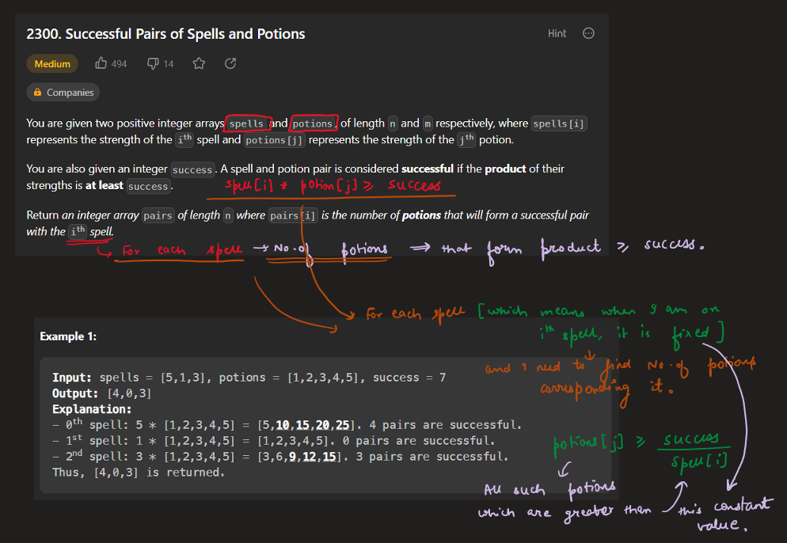
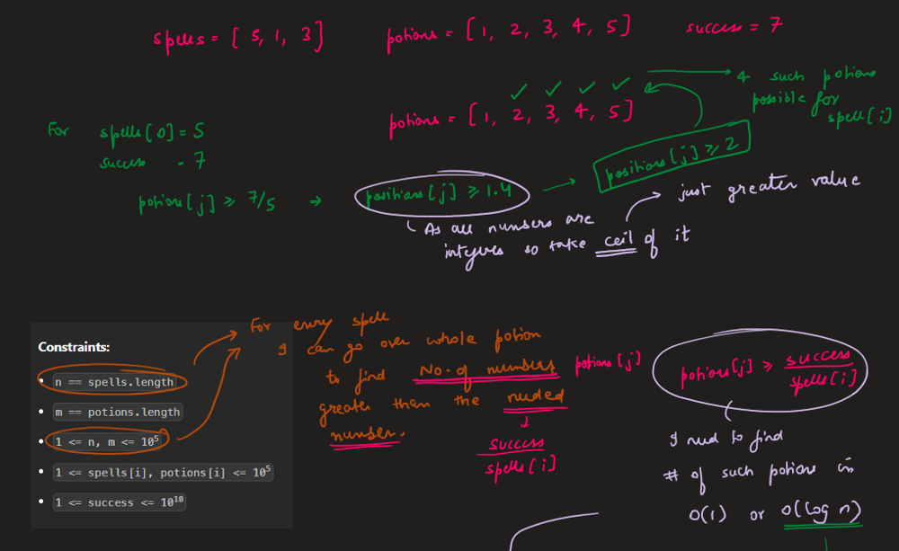
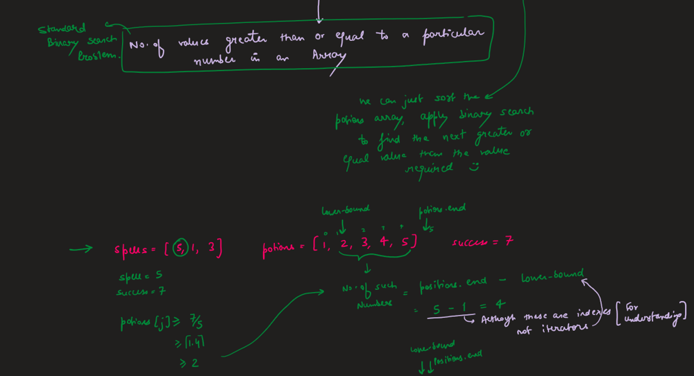
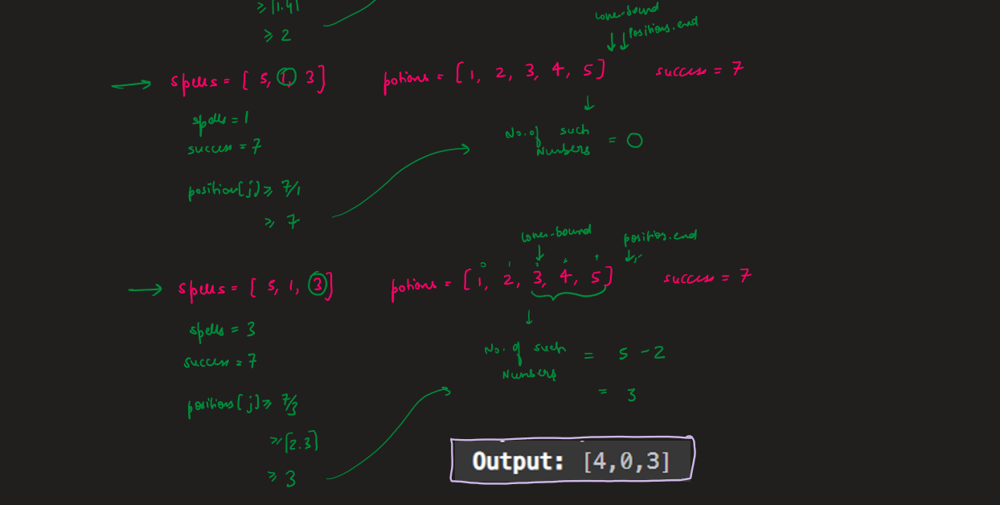
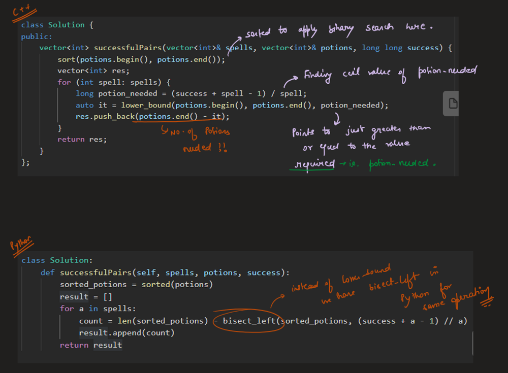
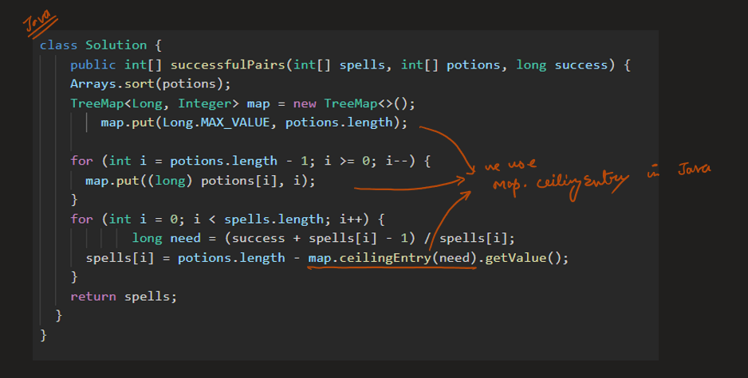
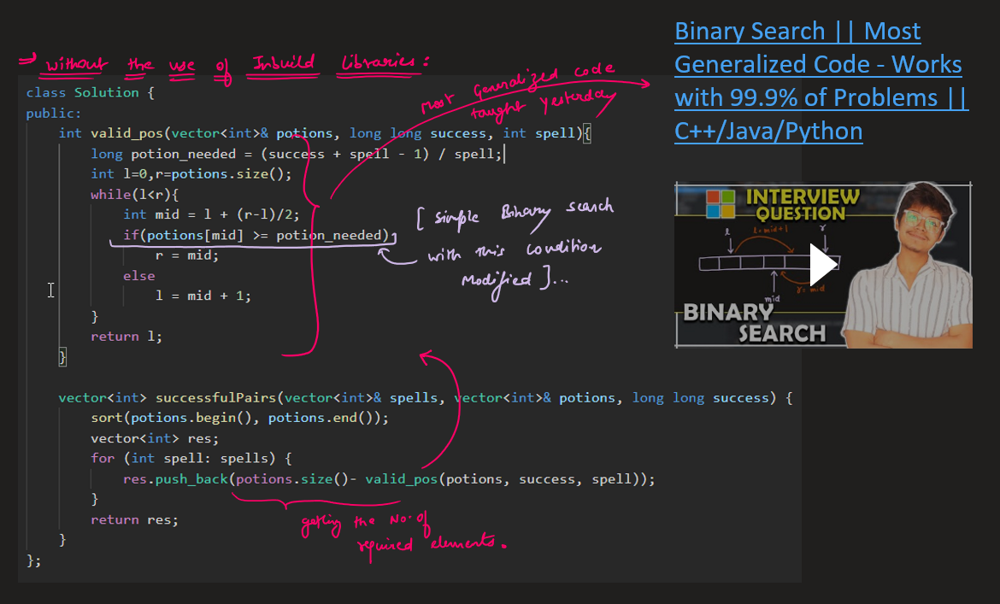

# Image Explanation🏆- [Binary Search with & without Inbuild Libraries] - C++/Java/Python

**Author:** aryan_0077
**Votes:** 47
**Link:** [https://leetcode.com/problems/successful-pairs-of-spells-and-potions/solutions/3367922/](https://leetcode.com/problems/successful-pairs-of-spells-and-potions/solutions/3367922/)

---

# Video Solution (`Aryan Mittal`) - Link in LeetCode Profile
`Successful Pairs of Spells and Potions` by `Aryan Mittal`


# Approach & Intution









# Code
```C++ []
class Solution {
public:
    vector<int> successfulPairs(vector<int>& spells, vector<int>& potions, long long success) {
        sort(potions.begin(), potions.end());
        vector<int> res;
        for (int spell: spells) {
            long potion_needed = (success + spell - 1) / spell;
            auto it = lower_bound(potions.begin(), potions.end(), potion_needed);
            res.push_back(potions.end() - it);
        }
        return res;
    }
};
```
```Java []
class Solution {
    public int[] successfulPairs(int[] spells, int[] potions, long success) {
		Arrays.sort(potions);
		TreeMap<Long, Integer> map = new TreeMap<>();
        map.put(Long.MAX_VALUE, potions.length);
        
		for (int i = potions.length - 1; i >= 0; i--) {
			map.put((long) potions[i], i);
		}
		for (int i = 0; i < spells.length; i++) {
            long need = (success + spells[i] - 1) / spells[i];
			spells[i] = potions.length - map.ceilingEntry(need).getValue();
		}
		return spells;
	}
}
```
```Python []
class Solution:
    def successfulPairs(self, spells, potions, success):
        sorted_potions = sorted(potions)
        result = []
        for a in spells:
            count = len(sorted_potions) - bisect_left(sorted_potions, (success + a - 1) // a)
            result.append(count)
        return result
```


# Code Without Inbuild Libraries
Exact same [Generalized Binary Search code](https://leetcode.com/problems/binary-search/solutions/3363888/image-explanation-most-generalized-binary-search-cjavapython/) discussed for C++/Java/Python.
```C++ []
class Solution {
public:
    int valid_pos(vector<int>& potions, long long success, int spell){
        long potion_needed = (success + spell - 1) / spell;

        int l=0,r=potions.size();
        while(l<r){
            int mid = l + (r-l)/2;
            if(potions[mid] >= potion_needed)
                r = mid;
            else
                l = mid + 1;
        }
        return l;
    }

    vector<int> successfulPairs(vector<int>& spells, vector<int>& potions, long long success) {
        sort(potions.begin(), potions.end());
        vector<int> res;
        for (int spell: spells) {
            res.push_back(potions.size()- valid_pos(potions, success, spell));
        }
        return res;
    }
};
```
```Java []
class Solution {
    public int valid_pos(int[] potions, long success, int spell) {
        long potion_needed = (success + spell - 1) / spell;
        int l = 0, r = potions.length;
        while (l < r) {
            int mid = l + (r - l) / 2;
            if (potions[mid] >= potion_needed)
                r = mid;
            else
                l = mid + 1;
        }
        return l;
    }

    public int[] successfulPairs(int[] spells, int[] potions, long success) {
        Arrays.sort(potions);
        int[] res = new int[spells.length];
        for (int i = 0; i < spells.length; i++) {
            res[i] = potions.length - valid_pos(potions, success, spells[i]);
        }
        return res;
    }
}
```
```Python []
class Solution:
    def valid_pos(self, potions: List[int], success: int, spell: int) -> int:
        potion_needed = (success + spell - 1) // spell
        l, r = 0, len(potions)
        while l < r:
            mid = l + (r - l) // 2
            if potions[mid] >= potion_needed:
                r = mid
            else:
                l = mid + 1
        return l

    def successfulPairs(self, spells: List[int], potions: List[int], success: int) -> List[int]:
        potions.sort()
        res = []
        for spell in spells:
            res.append(len(potions) - self.valid_pos(potions, success, spell))
        return res
```