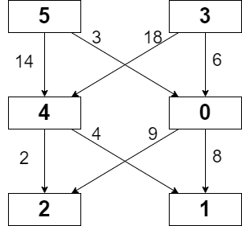

# Python Recursion + Memoization

**Author:** anCoderr
**Votes:** 16
**Link:** [https://leetcode.com/problems/minimum-path-cost-in-a-grid/solutions/2141004/](https://leetcode.com/problems/minimum-path-cost-in-a-grid/solutions/2141004/)

---

**Observations:**
1. This problem can be solved using recursion but simple recursion will lead to TLE.
2. If we make the recursion tree we can easily see that we will have a lot of redundant computations.

**For this example: *grid = [[5,3],[4,0],[2,1]], moveCost = [[9,8],[1,5],[10,12],[18,6],[2,4],[14,3]]***

**We can see that as we go from 5 to 4 and compute all paths for 4. In future we again reach 4 from 3 and compute all paths for 4 again. The computations made for 4 can be memoized be maintaining a dp array for each node. This will store the min cost path from that node and its node value. For 4 it will be path with cost 2 to Node 2. So dp[1][0] = dp for Node 4 = 2(Target Path Cost) + 2(Target Node Val) + 4 (Its Own Value).**
```
class Solution:
    def minPathCost(self, grid: List[List[int]], moveCost: List[List[int]]) -> int:
        max_row, max_col = len(grid), len(grid[0])
        dp = [[-1] * max_col for _ in range(max_row)] 

        def recursion(row, col):
            if row == max_row - 1: # If last row then return nodes value
                return grid[row][col]
            if dp[row][col] == -1: # If DP for this node is not computed then we will do so now.
                current = grid[row][col] # Current Node Value
                res = float('inf') # To store best path from Current Node
                for c in range(max_col): # Traverse all path from Current Node
                    val = moveCost[current][c] + recursion(row + 1, c) # Move cost + Target Node Value
                    res = min(res, val)
                dp[row][col] = res + current # DP[current node] = Best Path + Target Node Val + Current Node Val
            return dp[row][col]

        for c in range(max_col):
            recursion(0, c) # Start recursion from all nodes in 1st row
        return min(dp[0]) # Return min value from 1st row
```