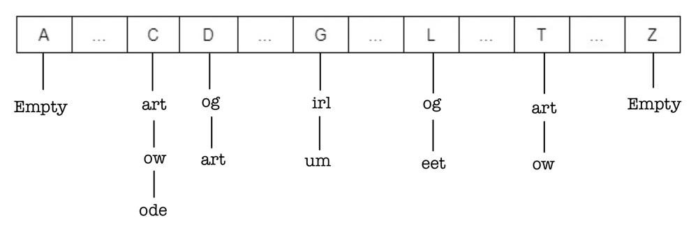
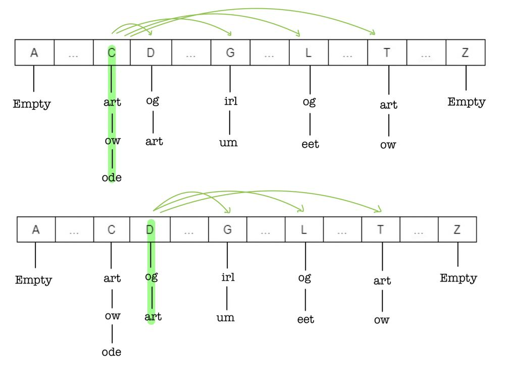
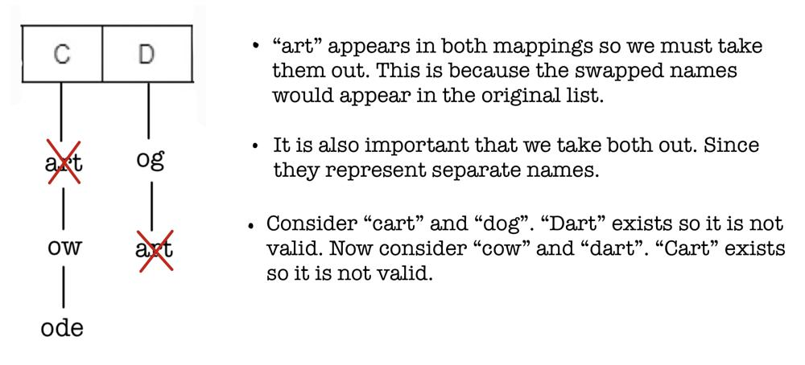
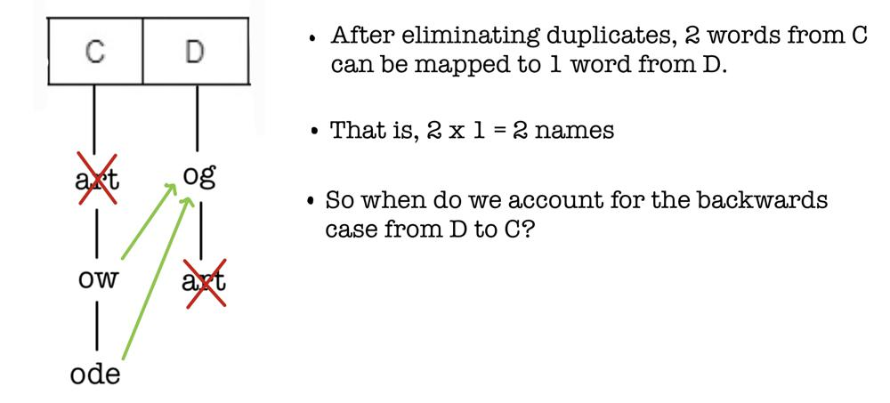
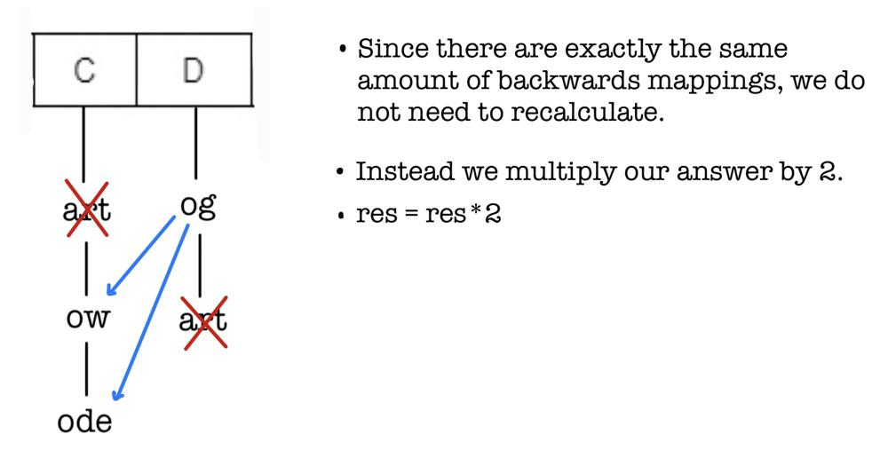
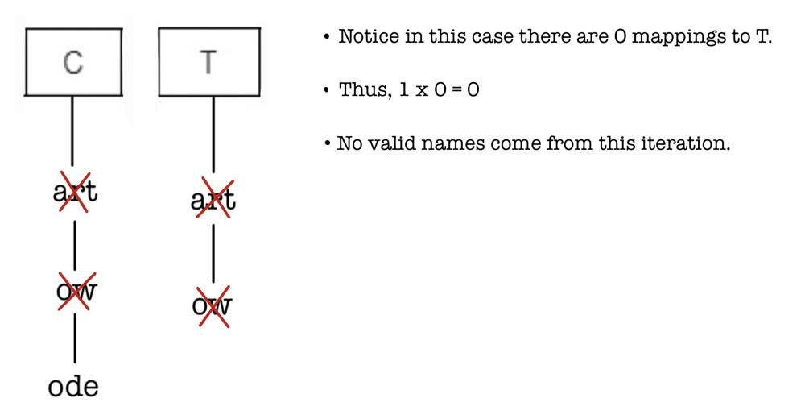

# ✅ Simple Diagram Example for Intuition ✅

**Author:** L30XL1U
**Votes:** 84
**Link:** [https://leetcode.com/problems/naming-a-company/solutions/3162541/](https://leetcode.com/problems/naming-a-company/solutions/3162541/)

---

##### This is a more detailed version of Lee's solution to help with the intuition. Solution credits to @Lee215. 
- Refer to his solution [here](https://leetcode.com/problems/naming-a-company/solutions/2141172/java-c-python-group-by-first-letter/?orderBy=most_votes). 

# Idea
- Use a list of hash sets to group together names that start with the same character. 
    -   The size of the list will be $$26$$ for every alphabet letter. 
- Using nested for loops, iterative through the list by comparing words from two different characters. 
- For each comparison, find total valid mappings. Double this value at the end since names can be flipped.  
# Example
- List `ideas` consists of `["cart", "cow", "code", "dog", "dart" "girl", "gum", "log", "leet", "tart", "tow"]`
- The array of hash sets for `ideas` looks like this:


- Notice we only save the substring of the name without the first letter.


- The above shows that once `i` checks `j`, `j` will not need to check `i` in `j`'s iteration because that would lead to double counting. Every valid name will be distinct. 
- Now let us consider a single iteration in detail: 




- Let us consider another iteration: 


- We see that by iteratively performing this mapping algorithm, we can get all valid, distinct names. 


# Code
```
long long distinctNames(vector<string>& ideas) {
        unordered_set<string> map[26]; 
        for (string& name : ideas){
            map[name[0]-'a'].insert(name.substr(1)); 
        }
        long long res = 0;
        for (int i = 0; i < 25; i++){
            for (int j = i+1; j < 26; j++){
                int total1 = 0, total2 = 0;
                for (auto& substring : map[i]){
                    if (map[j].find(substring) == map[j].end()){
                        total1++;
                    }
                }
                for (auto& substring : map[j]){
                    if (map[i].find(substring) == map[i].end()){
                        total2++;
                    }
                }
                res += total1*total2;
            }
        }
        return res*2;
    }
```


### Pleas upvote if this was helpful. Thanks!