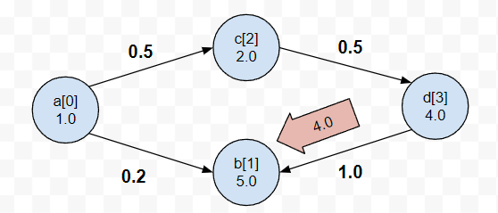

# DFS

**Author:** votrubac
**Votes:** 7
**Link:** [https://leetcode.com/problems/check-for-contradictions-in-equations/solutions/2161350/](https://leetcode.com/problems/check-for-contradictions-in-equations/solutions/2161350/)

---

We first convert equations into a bidirectional graph (`g`), where nodes represent variables, and edges - equations.

> We convert variable names into node ids to simplify things.

The weight of an edge is the value of the equation for the forward direction (`a / b = val`), and reciprocal for the opposite direction (`b / a = 1 / val`) .

Then, we do DFS starting from any unvisited node. We set the value of that node to `1.0`, navigate edges and compute respective values of connected nodes.

If we reach a node that already has a value, we check if the existing value is the same as we computed so far. If it's not, we have a contradiction.

The picture shows how the graph looks for the following example. As you can see, the value computed for node `"b"` from the `a -> b` equation path contradicts with the value from the `a -> c -> d -> b` path.
```
[["a", "b"], ["a", "c"], ["c", "d"], ["d", "a"]]
[0.2, 0.5, 0.5, 1.0]
```



**C++**
```cpp
double vis[1000] = {};
vector<pair<int, double>> g[1000] = {};
bool dfs(int i, double val) {
    if (vis[i] == 0) {
        vis[i] = val;
        for (auto [j, div] : g[i])
            if (dfs(j, val / div))
                return true;
    }
    return abs(vis[i] - val) >= 0.00001;
}
bool checkContradictions(vector<vector<string>>& es, vector<double>& values) {
    unordered_map<string, int> ids;
    for (auto &e : es) {
        if (ids.count(e[0]) == 0)
            ids[e[0]] = ids.size();
        if (ids.count(e[1]) == 0)
            ids[e[1]] = ids.size();
    }
    for (int i = 0; i < es.size(); ++i) {
        g[ids[es[i][0]]].push_back({ids[es[i][1]], values[i]});
        g[ids[es[i][1]]].push_back({ids[es[i][0]], 1.0 / values[i]});
    }
    for (int i = 0; i < ids.size(); ++i)
        if (vis[i] == 0 && dfs(i, 1.0))
            return true;
    return false;
}
```