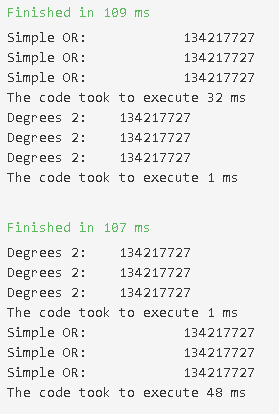

# Degrees 2 in the range 0..26

**Author:** sav20011962
**Votes:** 1
**Link:** [https://leetcode.com/problems/maximum-xor-after-operations/solutions/5890709/](https://leetcode.com/problems/maximum-xor-after-operations/solutions/5890709/)

---

# Approach
So, the premise of the decision:
1) Any number cannot become greater when the AND operation is performed on it with any other number. 
2) From any number in the array by performing (nums[i] AND (nums[i] XOR x))we can get all numbers from 0 to nums[i].
Thus, the original problem is transformed into the problem of finding all significant positions in all numbers in the array.
The first thing that comes to mind to realize this task, and at that the simplest (but hardly the most efficient) algorithmically, is the OR operation between all elements of the array.
I propose a different solution - I search not the numbers in the array, but the degrees 2 from zero to the maximum according to the constraints of the problem and try for each such value to find the first number in the array that contains a unit in the desired position. To reduce idle operations, I decided to apply a small trick - see in the code.

VAR1

```
class Solution {
    fun maximumXOR(nums: IntArray): Int {
        var rez = 0
        // val max = nums.max()
        for (N in arr) {
            // if (N>max) break
            if (nums.firstOrNull { (it and N) == N } != null) rez = rez or N
        }
        return rez
    }
    companion object {
        val arr = IntArray(27) {1 shl it}
    }
}
```
VAR2

```
class Solution {
    fun maximumXOR(nums: IntArray): Int {
        var rez = 0
        var N = 1 shl 26
        while (N>=1) {
            if (N and rez != N) {
                val tek = nums.firstOrNull { (it and N) == N }
                if (tek != null) rez = rez or tek
            }
            N = N shr 1
        }
        return rez
    }
}
```
Here is the result of a comparative test of two algorithms - the regular one with OR and mine with degree 2.
The tests were performed here, in the sandbox, on the same random arrays of different sizes for both functions:

