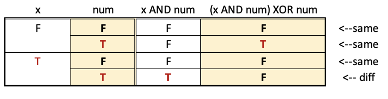

# Python3     ||  1 line, bit operations, w/ explanation    ||    T/S: 98% / 80%

**Author:** Spaulding_
**Votes:** 12
**Link:** [https://leetcode.com/problems/maximum-xor-after-operations/solutions/2366537/](https://leetcode.com/problems/maximum-xor-after-operations/solutions/2366537/)

---

Points to consider:

*  The problem calls for choosing an integer x, selecting an element n of the list, applying the compound operator op(n,x) = (x&n)^n,  and taking the bit-intersection of the modified set. Because of the associative and commutative properties of the XOR operator, it does not matter which n we choose in nums. 

*   Below is the truth table for op(num,x)

    The end result is that the op leaves num's bit unchanged unless x and num are both 1, in which case that bit of num becomes 0. It follows that by choosing x wisely, we can erase any bits in any of the elements of nums. 

*  For example:
              _ _ _ _ _ _ _ _ _ 3 =  0x4 + 1x2 + 1x1  = 011 (base2)
			  _ _ _ _ _ _ _ _ _ 2 =  0x4 + 1x2 + 0x1  = 010 (base2)
			  _ _ _ _ _ _ _ _ _ 4 =  1x4 + 0x2 + 0x1  = 100 (base2)
              _ _ _ _ _ _ _ _ _ 6 =  1x4 + 1x2 + 0x1  = 110 (base2)
			  
_ _ _ _ _ _ XOR (3,2,4,6)	=  0x4 + 1x2 + 1x1 = 011 (base2) = 3

In the base 2 representation of the XOR, the 4s digit is 0 because the bit-XOR of the 4s digits in nums,
XOR(0,0,1,1) = 0 because there's an even number of 1s. And:
  2s digits:  XOR(1,1,0,1)  => 2s digit of XOR(nums) = 1 because #of 1s is odd
   1s digits:  XOR(1,0,0,0)  => 1s digit of XOR(nums) = 1 because #of 1s is odd
   
*    After applying Op(4,6) = 2 to nums[3]:
              _ _ _ _ _ _ _ _ _ 3 =  0x4 + 1x2 + 1x1  = 011 (base2)
			  _ _ _ _ _ _ _ _ _ 2 =  0x4 + 1x2 + 0x1  = 010 (base2)
			  _ _ _ _ _ _ _ _ _ 4 =  1x4 + 0x2 + 0x1  = 100 (base2)
              _ _ _ _ _ _ _ _ _ 2 =  0x4 + 1x2 + 0x1  = 110 (base2)
			  
_ _ _ _ _  XOR (3,2,4,2)	=  1x4 + 1x2 + 1x1 = 111 (base2) = 7

*  The bottom line: choosing  a value of x that will reduce columns with even 1s by one will maximize the value of XOR(nums). The only columns that cannot be changed are those with no 1s initially. Thus we can solve the problem by determining OR(nums).

Three short solutions:
 
 ```
 class Solution:
    def maximumXOR(self, nums: List[int]) -> int:
        return reduce(lambda x,y: x|y, nums)

class Solution:
    def maximumXOR(self, nums: List[int]) -> int:
        return reduce(or_, nums)

class Solution:
    def maximumXOR(self, nums: List[int]) -> int:
        
        ans = 0
        for n in nums:
            ans |= n      
        return ans
```

[https://leetcode.com/problems/maximum-xor-after-operations/submissions/1286630818/](https://leetcode.com/problems/maximum-xor-after-operations/submissions/1286630818/)

I could be wrong, but I think that time complexity is *O*(*N*) and space complexity is *O*(1), in which *N* ~ `len(nums)`.

