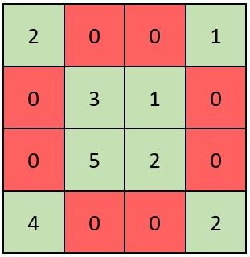
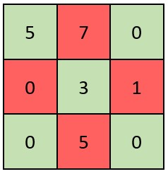

# [2319. Check if Matrix Is X-Matrix](https://leetcode.com/problems/check-if-matrix-is-x-matrix/)

| Category | Difficulty | Likes | Dislikes |
| :------: | :--------: | :---: | :------: |
| Algorithms | Easy | 538 | 26 |

**Tags:** [`array`](https://leetcode.com/tag/array), [`matrix`](https://leetcode.com/tag/matrix)

**Companies:** `google`

## Description

A square matrix is said to be an **X-Matrix** if **both** of the following conditions hold:

	- All the elements in the diagonals of the matrix are **non-zero**.

	- All other elements are 0.

Given a 2D integer array `grid` of size `n x n` representing a square matrix, return `true`* if *`grid`* is an X-Matrix*. Otherwise, return `false`.

 

**Example 1:**


```

Input: grid = [[2,0,0,1],[0,3,1,0],[0,5,2,0],[4,0,0,2]]
Output: true
Explanation: Refer to the diagram above. 
An X-Matrix should have the green elements (diagonals) be non-zero and the red elements be 0.
Thus, grid is an X-Matrix.

```

**Example 2:**


```

Input: grid = [[5,7,0],[0,3,1],[0,5,0]]
Output: false
Explanation: Refer to the diagram above.
An X-Matrix should have the green elements (diagonals) be non-zero and the red elements be 0.
Thus, grid is not an X-Matrix.

```

 

**Constraints:**

	- `n == grid.length == grid[i].length`

	- `3 <= n <= 100`

	- `0 <= grid[i][j] <= 10^5`

---

**Links:** [Submissions](https://leetcode.com/problems/check-if-matrix-is-x-matrix/) | [Solutions](https://leetcode.com/problems/check-if-matrix-is-x-matrix/)
