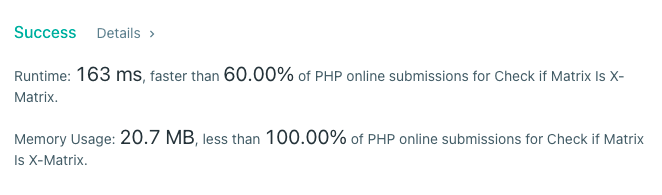

# PHP

**Author:** stuu
**Votes:** 1
**Link:** [https://leetcode.com/problems/check-if-matrix-is-x-matrix/solutions/2218457/](https://leetcode.com/problems/check-if-matrix-is-x-matrix/solutions/2218457/)

---


```
class Solution
{

  /**
   * @param Integer[][] $grid
   * @return Boolean
   */
  function checkXMatrix($grid)
  {

    // Check from top right diagnol to bottom right.
    $left_right_diagnol = [];
    $right_left_diagnol = [];
    $col_and_row_length = count($grid[0]) - 1;
    $odd_row_skip = false;

    if ((($col_and_row_length + 1) % 2 !== 0)) {
      $odd_row_skip =  ($col_and_row_length / 2) + 1;
      $odd_row_skip--;
    }
    $total_array_sum = 0;
    foreach ($grid as $row_num => $row) {

      $total_array_sum += array_sum($row);

      // Non negative diagnol check
      $right_left_val = $row[$col_and_row_length - $row_num];
      $left_right_val = $row[$row_num];
      if ($right_left_val === 0 || $left_right_val === 0) {
        return false;
      }
      if ($odd_row_skip && $row_num == $odd_row_skip) {

        $left_right_diagnol[] = $left_right_val;
      } else {
        $left_right_diagnol[] = $left_right_val;
        $right_left_diagnol[] = $right_left_val;
      }
    }


    // check that all other values are zero
    $sum_of_all_diagnols = array_sum($left_right_diagnol) + array_sum($right_left_diagnol);
    if ($sum_of_all_diagnols !== $total_array_sum) {
      return false;
    }

    return true;
  }
}