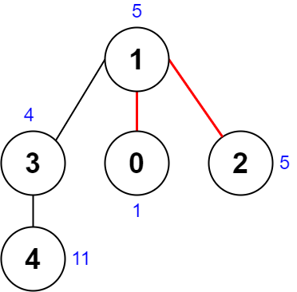
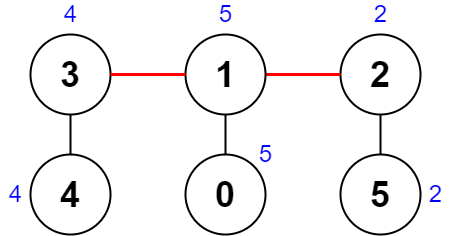

# [2322. Minimum Score After Removals on a Tree](https://leetcode.com/problems/minimum-score-after-removals-on-a-tree/)

| Category | Difficulty | Likes | Dislikes |
| :------: | :--------: | :---: | :------: |
| Algorithms | Hard | 806 | 46 |

**Tags:** [`array`](https://leetcode.com/tag/array), [`bit-manipulation`](https://leetcode.com/tag/bit-manipulation), [`tree`](https://leetcode.com/tag/tree), [`depth-first-search`](https://leetcode.com/tag/depth-first-search)

**Companies:** `google`, `facebook`, `amazon`

## Description

There is an undirected connected tree with `n` nodes labeled from `0` to `n - 1` and `n - 1` edges.

You are given a **0-indexed** integer array `nums` of length `n` where `nums[i]` represents the value of the `i^th` node. You are also given a 2D integer array `edges` of length `n - 1` where `edges[i] = [a_i, b_i]` indicates that there is an edge between nodes `a_i` and `b_i` in the tree.

Remove two **distinct** edges of the tree to form three connected components. For a pair of removed edges, the following steps are defined:

	- Get the XOR of all the values of the nodes for **each** of the three components respectively.

	- The **difference** between the **largest** XOR value and the **smallest** XOR value is the **score** of the pair.

	- For example, say the three components have the node values: `[4,5,7]`, `[1,9]`, and `[3,3,3]`. The three XOR values are `4 ^ 5 ^ 7 = 6`, `1 ^ 9 = 8`, and `3 ^ 3 ^ 3 = 3`. The largest XOR value is `8` and the smallest XOR value is `3`. The score is then `8 - 3 = 5`.

Return *the **minimum** score of any possible pair of edge removals on the given tree*.

 

**Example 1:**


```

Input: nums = [1,5,5,4,11], edges = [[0,1],[1,2],[1,3],[3,4]]
Output: 9
Explanation: The diagram above shows a way to make a pair of removals.
- The 1st component has nodes [1,3,4] with values [5,4,11]. Its XOR value is 5 ^ 4 ^ 11 = 10.
- The 2nd component has node [0] with value [1]. Its XOR value is 1 = 1.
- The 3rd component has node [2] with value [5]. Its XOR value is 5 = 5.
The score is the difference between the largest and smallest XOR value which is 10 - 1 = 9.
It can be shown that no other pair of removals will obtain a smaller score than 9.

```

**Example 2:**


```

Input: nums = [5,5,2,4,4,2], edges = [[0,1],[1,2],[5,2],[4,3],[1,3]]
Output: 0
Explanation: The diagram above shows a way to make a pair of removals.
- The 1st component has nodes [3,4] with values [4,4]. Its XOR value is 4 ^ 4 = 0.
- The 2nd component has nodes [1,0] with values [5,5]. Its XOR value is 5 ^ 5 = 0.
- The 3rd component has nodes [2,5] with values [2,2]. Its XOR value is 2 ^ 2 = 0.
The score is the difference between the largest and smallest XOR value which is 0 - 0 = 0.
We cannot obtain a smaller score than 0.

```

 

**Constraints:**

	- `n == nums.length`

	- `3 <= n <= 1000`

	- `1 <= nums[i] <= 10^8`

	- `edges.length == n - 1`

	- `edges[i].length == 2`

	- `0 <= a_i, b_i < n`

	- `a_i != b_i`

	- `edges` represents a valid tree.

---

**Links:** [Submissions](https://leetcode.com/problems/minimum-score-after-removals-on-a-tree/) | [Solutions](https://leetcode.com/problems/minimum-score-after-removals-on-a-tree/)
