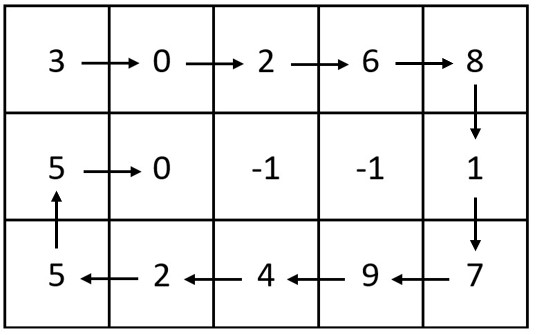
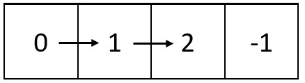

# [2326. Spiral Matrix IV](https://leetcode.com/problems/spiral-matrix-iv/)

| Category | Difficulty | Likes | Dislikes |
| :------: | :--------: | :---: | :------: |
| Algorithms | Medium | 1298 | 56 |

**Tags:** [`array`](https://leetcode.com/tag/array), [`linked-list`](https://leetcode.com/tag/linked-list), [`matrix`](https://leetcode.com/tag/matrix), [`simulation`](https://leetcode.com/tag/simulation)

**Companies:** `facebook`, `google`

## Description

You are given two integers `m` and `n`, which represent the dimensions of a matrix.

You are also given the `head` of a linked list of integers.

Generate an `m x n` matrix that contains the integers in the linked list presented in **spiral** order **(clockwise)**, starting from the **top-left** of the matrix. If there are remaining empty spaces, fill them with `-1`.

Return *the generated matrix*.

 

**Example 1:**


```

Input: m = 3, n = 5, head = [3,0,2,6,8,1,7,9,4,2,5,5,0]
Output: [[3,0,2,6,8],[5,0,-1,-1,1],[5,2,4,9,7]]
Explanation: The diagram above shows how the values are printed in the matrix.
Note that the remaining spaces in the matrix are filled with -1.

```

**Example 2:**


```

Input: m = 1, n = 4, head = [0,1,2]
Output: [[0,1,2,-1]]
Explanation: The diagram above shows how the values are printed from left to right in the matrix.
The last space in the matrix is set to -1.
```

 

**Constraints:**

	- `1 <= m, n <= 10^5`

	- `1 <= m * n <= 10^5`

	- The number of nodes in the list is in the range `[1, m * n]`.

	- `0 <= Node.val <= 1000`

---

**Links:** [Submissions](https://leetcode.com/problems/spiral-matrix-iv/) | [Solutions](https://leetcode.com/problems/spiral-matrix-iv/)
