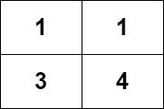

# [2328. Number of Increasing Paths in a Grid](https://leetcode.com/problems/number-of-increasing-paths-in-a-grid/)

| Category | Difficulty | Likes | Dislikes |
| :------: | :--------: | :---: | :------: |
| Algorithms | Hard | 2096 | 45 |

**Tags:** [`array`](https://leetcode.com/tag/array), [`dynamic-programming`](https://leetcode.com/tag/dynamic-programming), [`depth-first-search`](https://leetcode.com/tag/depth-first-search), [`breadth-first-search`](https://leetcode.com/tag/breadth-first-search), [`graph`](https://leetcode.com/tag/graph), [`topological-sort`](https://leetcode.com/tag/topological-sort), [`memoization`](https://leetcode.com/tag/memoization), [`matrix`](https://leetcode.com/tag/matrix)

**Companies:** `adobe`

## Description

You are given an `m x n` integer matrix `grid`, where you can move from a cell to any adjacent cell in all `4` directions.

Return *the number of **strictly** **increasing** paths in the grid such that you can start from **any** cell and end at **any** cell. *Since the answer may be very large, return it **modulo** `10^9 + 7`.

Two paths are considered different if they do not have exactly the same sequence of visited cells.

 

**Example 1:**


```

Input: grid = [[1,1],[3,4]]
Output: 8
Explanation: The strictly increasing paths are:
- Paths with length 1: [1], [1], [3], [4].
- Paths with length 2: [1 -&gt; 3], [1 -&gt; 4], [3 -&gt; 4].
- Paths with length 3: [1 -&gt; 3 -&gt; 4].
The total number of paths is 4 + 3 + 1 = 8.

```

**Example 2:**

```

Input: grid = [[1],[2]]
Output: 3
Explanation: The strictly increasing paths are:
- Paths with length 1: [1], [2].
- Paths with length 2: [1 -&gt; 2].
The total number of paths is 2 + 1 = 3.

```

 

**Constraints:**

	- `m == grid.length`

	- `n == grid[i].length`

	- `1 <= m, n <= 1000`

	- `1 <= m * n <= 10^5`

	- `1 <= grid[i][j] <= 10^5`

---

**Links:** [Submissions](https://leetcode.com/problems/number-of-increasing-paths-in-a-grid/) | [Solutions](https://leetcode.com/problems/number-of-increasing-paths-in-a-grid/)
