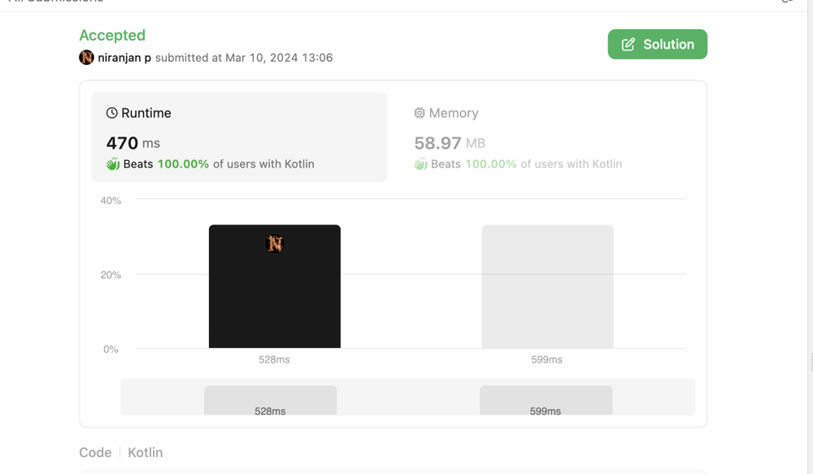

# Beats 100% kotlin solution

**Author:** niranjandroid
**Votes:** 0
**Link:** [https://leetcode.com/problems/the-latest-time-to-catch-a-bus/solutions/4852689/](https://leetcode.com/problems/the-latest-time-to-catch-a-bus/solutions/4852689/)

---




# Intuition
<!-- Describe your first thoughts on how to solve this problem. -->

# Approach
1. Since we need to assign passengers to bus, based on FIFS. We need assign both buses and passenger arrays so that we can iterate and assign
2. For each bus, we assign available passengers upto capacity
3. And after assigning we need to find maximum possible time that user can join get into bus
4. To do (3), we need to start with maximum possible time i.e, bus time
5. If all are assigned or the last passenger came at bus time (we can't have duplicated passenger times), we need to loop through all previous passengers until we find a gap (i.e, maximum possible time).
6. If we couldn't find max possible time based all previous passengers, we have to caluculate first passenger of bus and reduce 1 (assuming you would come before first passenger of bus)

# Complexity
- Time complexity:
<!-- Add your time complexity here, e.g. $$O(n)$$ -->

- Space complexity:
<!-- Add your space complexity here, e.g. $$O(n)$$ -->

# Code
```
class Solution {
    fun latestTimeCatchTheBus(buses: IntArray, passengers: IntArray, capacity: Int): Int {
        buses.sort()
        passengers.sort()

        var pIndex = 0
        var latestTime = 0

        for(bus in buses) {

            var minP = pIndex
            var filledPassengers = 0

            for(i in pIndex until passengers.size) {
                if(passengers[i] <= bus && filledPassengers < capacity) {
                    pIndex++
                    filledPassengers++
                } else {
                    break
                }
            }

            var tmp = passengers[0] - 1
            if(filledPassengers < capacity && (pIndex == 0 || passengers[pIndex - 1] < bus)) {
                tmp = bus
            } else {
                var cp = pIndex - 1 // last passenger index in current bus
                while(cp > 0) { //Checking for unique maximum possible time
                    if(passengers[cp] - 1 != passengers[cp - 1]) {
                        tmp = passengers[cp] - 1
                        break
                    }
                    cp--
                }
            }
            latestTime = tmp
        }
        return latestTime

    }
}
```