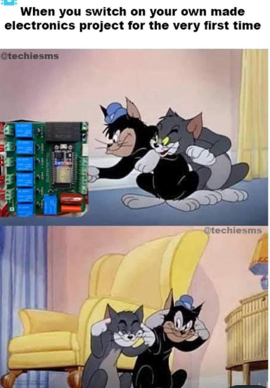

# ✅ Full Explanation  | C++,Python, Java Code | with comment | Stack | O(N) |

**Author:** nitin23rathod
**Votes:** 51
**Link:** [https://leetcode.com/problems/subarray-with-elements-greater-than-varying-threshold/solutions/2259305/](https://leetcode.com/problems/subarray-with-elements-greater-than-varying-threshold/solutions/2259305/)

---

**PLEASE UPVOTE IF YOU FIND MY APPROACH HELPFUL, MEANS A LOT \uD83D\uDE0A**
The question says that we need to find any such subarray which has the property that all the elements in that **subarray are > threshold / k**.

The gist of the above statement is that we need to find the subarray minimum and we need to expand that subarray as max as possible so as to have as less threshold / k as possible.

**Approch:-**
* We consider the current element as the minimum element and try to find out the prev smaller and next smaller elements.
* Once we know that, we can calculate the max.
* subarray length K which will allow us to get least threshold / k.
**Please Upvote if you like**
**Time Complaxity :-** `O(N)`

**C++**
```
class Solution {
public:
    int validSubarraySize(vector<int>& nums, int threshold) {
        int n = nums.size();
        vector<long long> lr(n, n), rl(n, -1);
        
        vector<int> s;
        for(int i = 0; i < n; ++i) {
            while(!s.empty() and nums[i] < nums[s.back()]) {
                lr[s.back()] = i;
                s.pop_back();
            }
            s.push_back(i);
        }
        s.clear();
        for(int i = n - 1; ~i; --i) {
            while(!s.empty() and nums[i] < nums[s.back()]) {
                rl[s.back()] = i;
                s.pop_back();
            }
            s.push_back(i);
        }
        
        for(int i = 0; i < n; ++i) {
            long long length = lr[i] - rl[i] - 1;
            if(1LL * nums[i] * length > threshold) return length;
        }
        
        return -1;
    }
};
// please upvote if you like
```

**Python:-**
```
def validSubarraySize(self, nums: List[int], threshold: int) -> int:
        nums = [0] + nums + [0]
        stack = [0]
        for i in range(1,len(nums)):
            while nums[i] < nums[stack[-1]]:
                tmp = nums[stack.pop()]
                if tmp > threshold / (i - stack[-1] - 1):
                    return i - stack[-1] - 1
            stack.append(i)
        return -1
```

**Java:-**

1. If the minimun value of A min(A) > threshold / len(A) then A is one of the answer.
2. If any element x <= threshold / len(A), A cannot be the answer. We call x a bad point.
3. A can be divide into segments by these bad points.

We can find those segments and recursively validate each one.
**Code:-**
```
public int validSubarraySize(int[] nums, int threshold) {
        int n = nums.length;
        return dfs(nums, 0, n - 1, threshold);
    }
    
    private int dfs(int[] nums, int l, int r, int t) {
        if(l > r) {
            return -1;
        }
        if(l == r) {
            return nums[l] > t ? 1 : -1;
        }
        
        int n = r - l + 1;
        for(int i = l; i <= r; ) {
            if(nums[i] <= t / n) {
                i++;
                continue;
            }
            int j = i;
            int min = Integer.MAX_VALUE;
            while(i <= r && nums[i] > t / n) {
                min = Math.min(min, nums[i]);
                i++;
            }
            
            if(min > t / (i - j)) {
                return i - j;
            }
            
            int res = dfs(nums, j, i - 1, t);
                
            if(res != -1) {
                return res;
            }
        }
        
        return -1;
    }
```
 **For FuN \uD83D\uDE01\uD83E\uDD23\uD83E\uDD23**




