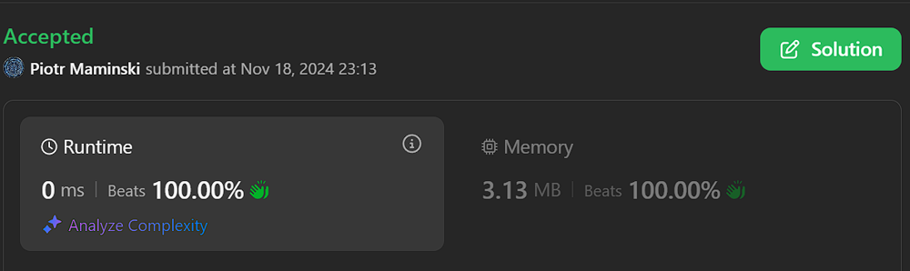

# ✅ Video | Simple and Short | Beats 94-100% RAM: 99%

**Author:** Piotr_Maminski
**Votes:** 0
**Link:** [https://leetcode.com/problems/minimum-adjacent-swaps-to-make-a-valid-array/solutions/6060033/](https://leetcode.com/problems/minimum-adjacent-swaps-to-make-a-valid-array/solutions/6060033/)

---



https://youtu.be/UlvnPb0fRlE?si=c_7v2bFkFx2je_CW
```python3 []
class Solution:
    def minimumSwaps(self, nums: List[int]) -> int:
        
        lo_loc = nums.index(min(nums))
        nums.reverse()
        hi_loc = nums.index(max(nums))

        total = lo_loc + hi_loc

        if lo_loc > (len(nums)-1 - hi_loc):
            total -= 1

        return total
```
```cpp []
class Solution {
public:
    int minimumSwaps(vector<int>& nums) {
        auto minIt = min_element(nums.begin(), nums.end());
        int loLoc = distance(nums.begin(), minIt);
        
        reverse(nums.begin(), nums.end());
        
        auto maxIt = max_element(nums.begin(), nums.end());
        int hiLoc = distance(nums.begin(), maxIt);
        
        int total = loLoc + hiLoc;
        
        if (loLoc > (nums.size() - 1 - hiLoc)) {
            total -= 1;
        }
        
        return total;
    }
};
```
```java []
class Solution {
    public int minimumSwaps(int[] nums) {
        int loLoc = 0;
        int minVal = nums[0];
        
        for (int i = 1; i < nums.length; i++) {
            if (nums[i] < minVal) {
                minVal = nums[i];
                loLoc = i;
            }
        }
        
        int[] reversed = new int[nums.length];
        for (int i = 0; i < nums.length; i++) {
            reversed[i] = nums[nums.length - 1 - i];
        }
        
        int hiLoc = 0;
        int maxVal = reversed[0];
        for (int i = 1; i < reversed.length; i++) {
            if (reversed[i] > maxVal) {
                maxVal = reversed[i];
                hiLoc = i;
            }
        }
        
        int total = loLoc + hiLoc;
        
        if (loLoc > (nums.length - 1 - hiLoc)) {
            total -= 1;
        }
        
        return total;
    }
}
```
```csharp []
public class Solution {
    public int MinimumSwaps(int[] nums) {
        int loLoc = Array.IndexOf(nums, nums.Min());
        
        Array.Reverse(nums);
        int hiLoc = Array.IndexOf(nums, nums.Max());
        
        int total = loLoc + hiLoc;
        
        if (loLoc > (nums.Length - 1 - hiLoc)) {
            total -= 1;
        }
        
        return total;
    }
}
```
```golang []
func minimumSwaps(nums []int) int {
    loLoc := 0
    minVal := nums[0]
    
    for i := 1; i < len(nums); i++ {
        if nums[i] < minVal {
            minVal = nums[i]
            loLoc = i
        }
    }
    
    reversed := make([]int, len(nums))
    for i := 0; i < len(nums); i++ {
        reversed[i] = nums[len(nums)-1-i]
    }
    
    hiLoc := 0
    maxVal := reversed[0]
    for i := 1; i < len(reversed); i++ {
        if reversed[i] > maxVal {
            maxVal = reversed[i]
            hiLoc = i
        }
    }
    
    total := loLoc + hiLoc
    
    if loLoc > (len(nums)-1-hiLoc) {
        total -= 1
    }
    
    return total
}
```
```swift []
class Solution {
    func minimumSwaps(_ nums: [Int]) -> Int {
        let loLoc = nums.firstIndex(of: nums.min()!)!
        
        let reversed = Array(nums.reversed())
        let hiLoc = reversed.firstIndex(of: nums.max()!)!
        
        var total = loLoc + hiLoc
        
        if loLoc > (nums.count - 1 - hiLoc) {
            total -= 1
        }
        
        return total
    }
}
```
```javascript [JS]
// JavaScript

var minimumSwaps = function(nums) {
    const loLoc = nums.indexOf(Math.min(...nums));
    
    const reversed = [...nums].reverse();
    const hiLoc = reversed.indexOf(Math.max(...nums));
    
    let total = loLoc + hiLoc;
    
    if (loLoc > (nums.length - 1 - hiLoc)) {
        total -= 1;
    }
    
    return total;
};
```
```typescript [TS]
// TypeScript

function minimumSwaps(nums: number[]): number {
    const loLoc: number = nums.indexOf(Math.min(...nums));
    
    const reversed: number[] = [...nums].reverse();
    const hiLoc: number = reversed.indexOf(Math.max(...nums));
    
    let total: number = loLoc + hiLoc;
    
    if (loLoc > (nums.length - 1 - hiLoc)) {
        total -= 1;
    }
    
    return total;
}
```
```rust []
impl Solution {
    pub fn minimum_swaps(nums: Vec<i32>) -> i32 {
        let n = nums.len();
        let mut min_idx = 0;
        let mut max_idx = 0;
        
        for i in 0..n {
            if nums[i] < nums[min_idx] {
                min_idx = i;
            }
            if nums[i] >= nums[max_idx] {
                max_idx = i;
            }
        }

        let mut swaps = min_idx + (n - 1 - max_idx);
        
        if min_idx > max_idx {
            swaps -= 1;
        }
        
        swaps as i32
    }
}
```
```ruby []
def minimum_swaps(nums)
    lo_loc = nums.index(nums.min)
    
    nums.reverse!
    hi_loc = nums.index(nums.max)
    
    total = lo_loc + hi_loc
    
    if lo_loc > (nums.length - 1 - hi_loc)
        total -= 1
    end
    
    total
end
```
- Complexity: Time O(n) & Space O(1)


