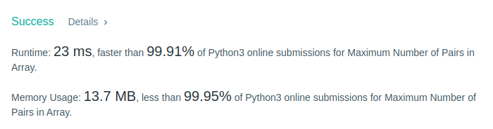
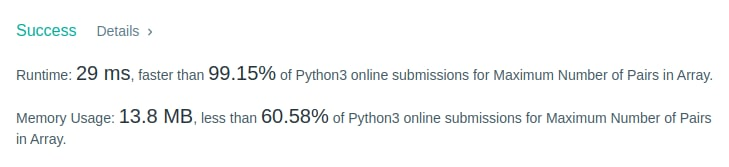

# Python Elegant & Short | Two lines | 99.91% faster | Counter

**Author:** Kyrylo-Ktl
**Votes:** 14
**Link:** [https://leetcode.com/problems/maximum-number-of-pairs-in-array/solutions/2472693/](https://leetcode.com/problems/maximum-number-of-pairs-in-array/solutions/2472693/)

---

	class Solution:
		"""
		Time:   O(n)
		Memory: O(n)
		"""

		def numberOfPairs(self, nums: List[int]) -> List[int]:
			pairs = sum(cnt // 2 for cnt in Counter(nums).values())
			return [pairs, len(nums) - 2 * pairs]

	class Solution:
		"""
		Time:   O(n)
		Memory: O(n)
		"""

		def numberOfPairs(self, nums: List[int]) -> List[int]:
			pairs = 0
			single = set()

			for num in nums:
				if num in single:
					single.remove(num)
					pairs += 1
				else:
					single.add(num)

			return [pairs, len(single)]

