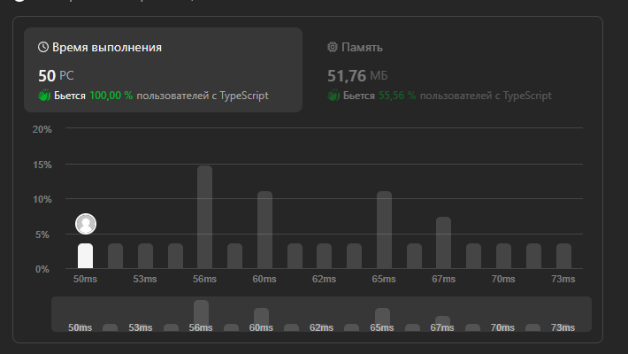

# 🔥[EASY] RunTime (100%/50PC) For beginners / Small solution🔥

**Author:** seba1337
**Votes:** 1
**Link:** [https://leetcode.com/problems/maximum-number-of-pairs-in-array/solutions/4865755/](https://leetcode.com/problems/maximum-number-of-pairs-in-array/solutions/4865755/)

---

# Intuition
The problem addresses finding the number of pairs of equal elements in an array. The TypeScript code utilizes nested loops to iterate through the array, identifying pairs and using a `Set (hash)` to keep track of the indices forming pairs.

# Approach
The approach involves nested loops to compare each element with the remaining elements in the array. When a pair is found, the indices of the elements are added to the Set to prevent reconsideration. The result is an array containing the count of pairs and the count of elements without a pair.

# Complexity
- Time complexity: `O(n^2)` - The nested loops result in a quadratic time complexity as they iterate through the array.
- Space complexity: `O(n)` - The Set (hash) stores the indices of elements forming pairs, resulting in linear space complexity.

# Code
```
function numberOfPairs(nums: number[]): number[] {
    const hash = new Set();

    loop: for(let i = 0; i < nums.length; i++) {

        for(let j = i + 1; j < nums.length; j++) {
            if(nums[i] === nums[j] && !hash.has(j) && !hash.has(i)) {
                hash.add(j)
                hash.add(i)
                continue loop;
            }
        }

    }

    return [hash.size / 2,nums.length - hash.size]
};
```
image.png
