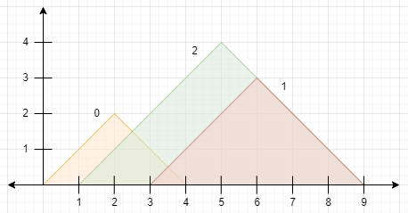
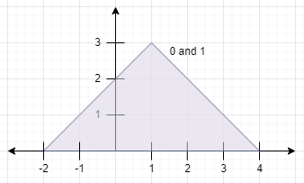

# [2345. Finding the Number of Visible Mountains](https://leetcode.com/problems/finding-the-number-of-visible-mountains/)

| Category | Difficulty | Likes | Dislikes |
| :------: | :--------: | :---: | :------: |
| Algorithms | Medium | 174 | 79 |

**Tags:** [`array`](https://leetcode.com/tag/array), [`stack`](https://leetcode.com/tag/stack), [`sorting`](https://leetcode.com/tag/sorting), [`monotonic-stack`](https://leetcode.com/tag/monotonic-stack)

**Companies:** `google`

## Description

You are given a **0-indexed** 2D integer array `peaks` where `peaks[i] = [x_i, y_i]` states that mountain `i` has a peak at coordinates `(x_i, y_i)`. A mountain can be described as a right-angled isosceles triangle, with its base along the `x`-axis and a right angle at its peak. More formally, the **gradients** of ascending and descending the mountain are `1` and `-1` respectively.

A mountain is considered **visible** if its peak does not lie within another mountain (including the border of other mountains).

Return *the number of visible mountains*.

 

**Example 1:**


```

Input: peaks = [[2,2],[6,3],[5,4]]
Output: 2
Explanation: The diagram above shows the mountains.
- Mountain 0 is visible since its peak does not lie within another mountain or its sides.
- Mountain 1 is not visible since its peak lies within the side of mountain 2.
- Mountain 2 is visible since its peak does not lie within another mountain or its sides.
There are 2 mountains that are visible.
```

**Example 2:**


```

Input: peaks = [[1,3],[1,3]]
Output: 0
Explanation: The diagram above shows the mountains (they completely overlap).
Both mountains are not visible since their peaks lie within each other.

```

 

**Constraints:**

	- `1 <= peaks.length <= 10^5`

	- `peaks[i].length == 2`

	- `1 <= x_i, y_i <= 10^5`

---

**Links:** [Submissions](https://leetcode.com/problems/finding-the-number-of-visible-mountains/) | [Solutions](https://leetcode.com/problems/finding-the-number-of-visible-mountains/)
