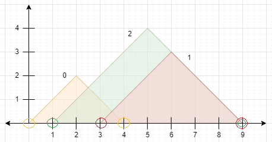
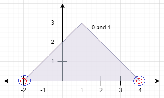
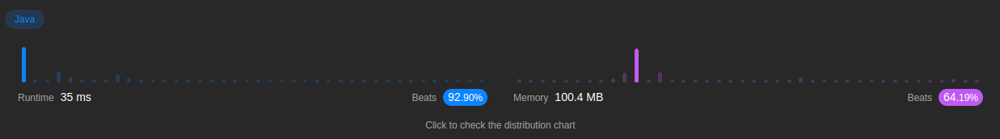

# Focus on the base of the mountain and not the peak

**Author:** user8184Aj
**Votes:** 17
**Link:** [https://leetcode.com/problems/finding-the-number-of-visible-mountains/solutions/3073237/](https://leetcode.com/problems/finding-the-number-of-visible-mountains/solutions/3073237/)

---

# Intuition

Please notice that for a mountaind to be shadowed its base will be between the bases of bigger mountains. So the trick here is to alter the peaks array to actually inform the left and right points of the base.




Just keep an eye for the cases where two montains shadow each other, i.e they have the same bases.




Steps:
1. Sort the mountains using the left edge of the base, and if they have same values prioritize the biggest one (the one with farthest right edge base).
2. Go through the array ignoring values that are between bases. And only use the ones with biggest base to keep track for shadowing (but do not count the mountains in this case as they shadow themselves also). all other cases increase counter.

# Approach
- Sorting

# Complexity
- Time complexity:
$$O(n*log(n))$$

- Space complexity:
$$O(log(n))$$ <- Although we reuse the array, Java `Arrays.sort()` uses this space complexity (so as we call this method we must count it too). 

# Code


```java
class Solution {
    public int visibleMountains(int[][] peaks) {
        if(peaks.length==1) return 1;
        for(int i=0;i<peaks.length;i++) {
            int x=peaks[i][0], y=peaks[i][1];
            peaks[i][0]=x-y;
            peaks[i][1]=x+y;
        }
        Arrays.sort(peaks,(a,b)->a[0]==b[0]?b[1]-a[1]:a[0]-b[0]);
        int count=peaks[0][0]==peaks[1][0]&&peaks[0][1]==peaks[1][1]?0:1;
        int maxRight=peaks[0][1];
        for(int i=0;i<peaks.length;i++) {
            int[] next=peaks[i];
            if(next[1]<=maxRight) continue;
            maxRight=next[1];
            if(i==peaks.length-1||next[0]!=peaks[i+1][0]||maxRight!=peaks[i+1][1]) count++;
        }
        return count;
    }
}
```