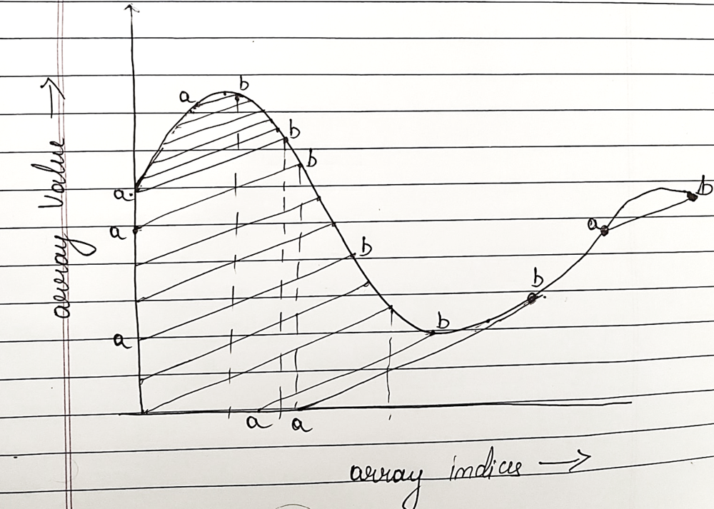

# O(n) solution using Stack

**Author:** rishabhkediyal18
**Votes:** 0
**Link:** [https://leetcode.com/problems/maximum-number-of-books-you-can-take/solutions/3668356/](https://leetcode.com/problems/maximum-number-of-books-you-can-take/solutions/3668356/)

---

# Intuition
<!--  2.  -->
If we can find the solution of each shelf while including the exact no of books from the current shelf then we can scan the array for maxima.
A solution for i, such that i<j can be used while calculating solution for j, only when 
    1. books[i]<books[j]-(i-j),
    2. books[k]>books[j]-(k-j). for all k between i and j
otherwise the criteria of strictly increasing sequence will fail.
Two observations that we can make at the very outset - 
1. If while traversing the array the sequence is strictly increasing then we can directly use the solution of the previous index.
2. if the sequence is decreasing then we use the last entry that satisfy the above criteria, and use that index. In this case we would have to add the books corresponding to the distance between last index and current index. (since the sequence is strictly decreasing in this case, we can be assured that every shelf in between will have atleast that number of books that we want to pick up)



Here is the pictorial representation of the same, for each 'b' we find a point 'a' that satisfies the condition. and area under a-b is what we add to the solution of 'a' to find solution of b.
- note: line joing a and b has a slope (ideally slope of 1, in order to ensure a strictly increasing sequence)
# Approach
<!-- Describe your approach to solving the problem. -->

To maintain the last index that we can use, we use a stack. Traverse the array, Pop the stack till we find the element satisfying the condition or stack is empty. Use it to find the books for current one, add the books corresponding to the distance between the top of stack and current, and add the current to the top of the stack.
Since the current is greater than the top (as per the above criteria) we dont violate our rule.

I have used a separate function to calculate the no of books correspondin to the distance between 'a' and 'b'.

# Complexity
- Time complexity: O(n)
- We iterate over the array once.
- Each element is added once and removed once from the stack the inner while loop does not increase the complexity.
<!-- Add your time complexity here, e.g. $$O(n)$$ -->

- Space complexity:
max space taken by the stack = n
therefor, O(n)
<!-- Add your space complexity here, e.g. $$O(n)$$ -->

# Code
```
public class Solution {
    public long GetMaxSince(int index, int height, int lastIndex)
    {
        //Console.Write("** i:"+index+" h:"+height+" last_i:"+lastIndex);
        long maxsince = 0;
        float triangleArea = 0;
        if(height==0)
            maxsince = 0;
        else
        {
            if(lastIndex==index-1)
            {
                maxsince = height;
            }
            else
            {
                index = index-lastIndex;
                //triangleArea = (float)((index)*(float)(index-1))/2;
                if(height>=index)
                {
                    maxsince = (long)index*(long)(2*height-index+1)/2;
                }
                else
                {
                    maxsince = (height)*(height+1)/2;
                }
            }
        }
        //Console.Write(" maxsince:"+maxsince);
        //Console.WriteLine("**");
        return maxsince;
    }
    public long MaximumBooks(int[] books) {
        // index, MaxBooks
        Stack<(int,long)> highestUsable = new Stack<(int,long)>();
        long curMax = 0;
        long max = -1;
        for(int i=0;i<books.Count();i++)
        {
            //Console.WriteLine("Before Stack count = "+highestUsable.Count());
            (int index, long maxBooks) node;
            while(highestUsable.Count()>0)
            { 
                node = highestUsable.Peek();
                if(books[node.index]>books[i]-(i-node.index))
                {
                    highestUsable.Pop();
                }
                else
                {
                    break;
                }
            }
            //Console.WriteLine("After Stack count = "+highestUsable.Count());
            if(highestUsable.Count()==0)
            {
                curMax = GetMaxSince(i,books[i],-1);
                highestUsable.Push((i,curMax));
            }
            else
            {
                (int index, long maxbooks) lastnode;
                lastnode = highestUsable.Peek();
                //Console.WriteLine("LN index "+lastnode.index+ " LN books "+lastnode.maxbooks);
                curMax = GetMaxSince(i,books[i],lastnode.index) + lastnode.maxbooks;
                highestUsable.Push((i, curMax));
            }
            //Console.WriteLine("Curmax "+curMax+ " index "+i);
            max = (max>curMax)?max:curMax;
        }
        return max;
    }
}
```