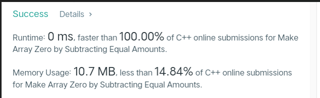
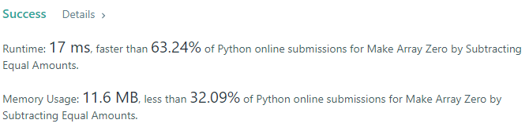
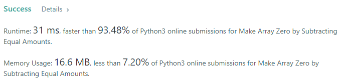
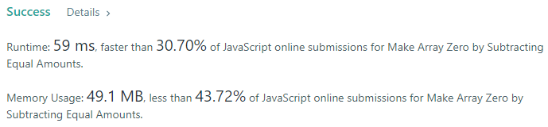
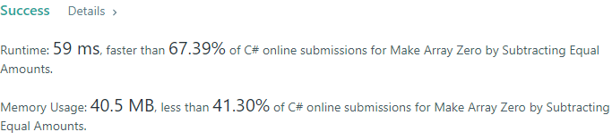
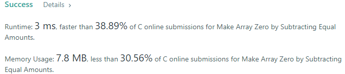

# 💢☠💫Easiest👾Faster✅💯 Lesser🧠 🎯 C++✅Python3🐍✅Java✅C✅Python🐍✅C#✅💥🔥💫Explained☠💥🔥 Beats 💯

**Author:** Edwards310
**Votes:** 7
**Link:** [https://leetcode.com/problems/make-array-zero-by-subtracting-equal-amounts/solutions/5628223/](https://leetcode.com/problems/make-array-zero-by-subtracting-equal-amounts/solutions/5628223/)

---

# Intuition







```javascript []
//Javascript code
/**
 * @param {number[]} nums
 * @return {number}
 */
var minimumOperations = function(nums) {
    const set = new Set()
    for(let x of nums)
        if(x !== 0)
            set.add(x)
    return set.size
};
```
```C++ []
//C++ code
class Solution {
public:
    int minimumOperations(vector<int>& nums) {
        ios_base::sync_with_stdio(false);
        cin.tie(NULL);;
        unordered_set<int> st;
        for(int x : nums)
            if(x)
                st.insert(x);
        return st.size();
    }
};
```
```Python3 []
#Python3 code
class Solution:
    def minimumOperations(self, nums: List[int]) -> int:
        return len(set(nums) - {0})
```
```Java []
//Java code
class Solution {
    public int minimumOperations(int[] nums) {
        HashSet<Integer> st = new HashSet<>();
        for(int x : nums)
            if(x != 0)
                st.add(x);
        return st.size();
    }
}
```
```C []
//C code
int minimumOperations(int* nums, int numsSize) {
    bool set[101] = {};
    for(int i = 0; i < numsSize; ++i)
        set[nums[i]] = true;
    int ans = 0;
    for(int i = 1; i < 101; i++)
        if(set[i])
            ++ans;
    return ans;
}
```
```Python []
#Python code
class Solution(object):
    def minimumOperations(self, nums):
        """
        :type nums: List[int]
        :rtype: int
        """
        return len(set(x for x in nums if x != 0))
```
```C# []
//C# code
public class Solution {
    public int MinimumOperations(int[] nums) {
        HashSet<int> st = new HashSet<int>();
        foreach(int x in nums)
            if(x != 0)
                st.Add(x);
        return st.Count();
    }
}
```
<!-- Describe your first thoughts on how to solve this problem. -->

# Approach
<!-- Describe your approach to solving the problem. -->

# Complexity
- Time complexity:
<!-- Add your time complexity here, e.g. $$O(n)$$ -->

- Space complexity:
<!-- Add your space complexity here, e.g. $$O(n)$$ -->

# Code
```
int minimumOperations(int* nums, int numsSize) {
    bool set[101] = {};
    for(int i = 0; i < numsSize; ++i)
        set[nums[i]] = true;
    int ans = 0;
    for(int i = 1; i < 101; i++)
        if(set[i])
            ++ans;
    return ans;
}
```

