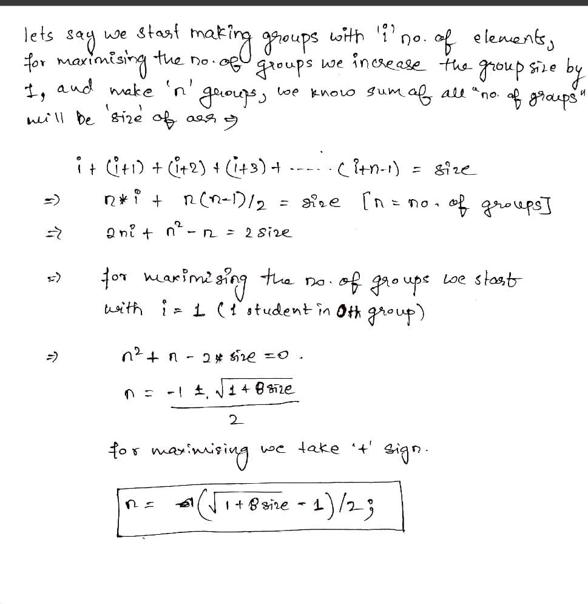

# ✅✅ Quadratic formula O(1) || Smallest Solution || One liner || with intuition[beats 100%]

**Author:** 2uringTested
**Votes:** 9
**Link:** [https://leetcode.com/problems/maximum-number-of-groups-entering-a-competition/solutions/3621117/](https://leetcode.com/problems/maximum-number-of-groups-entering-a-competition/solutions/3621117/)

---

# Intuition
<!-- Describe your first thoughts on how to solve this problem. -->

M

# Complexity
- Time complexity: $$O(1)$$
- Space complexity: $$O(1)$$


# Code
```
class Solution {
public:
    int maximumGroups(vector<int>& grades) {
        int D = sqrt(1+8*grades.size());
        int B = 1;
        return (-B+D)/2;
    }
};
```