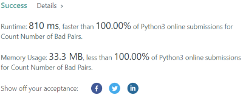

# 🔥 Python || Detailed Explanation ✅ || Faster Than 100% ✅|| Less than 100% ✅ || Simple || MATH

**Author:** wingskh
**Votes:** 42
**Link:** [https://leetcode.com/problems/count-number-of-bad-pairs/solutions/2388687/](https://leetcode.com/problems/count-number-of-bad-pairs/solutions/2388687/)

---

**Appreciate if you could upvote this solution**


Method: `math`

First, we know that the number of pair combinations for nums is `nCr`
Also, the condition can transform from `i-j != num[j]-num[i]` to `num[i]-i != num[j]-j` via basic calculation.
Thus, the result should be `nCr - num_of_pairs(num[i]-i == num[j]-j)`
Then, we can use a `dict` to store the duplication counts.

For example, `nums = [4, 1, 3, 3, 5, 5]`
Then, transforming `nums` to `[4, 0, 1, 0, 1, 0]`
and the duplication count dict equals to
```
{
	0: 3 // the values stored in indexes 1, 3 and 5 are 0 
	1: 2 // the values stored in indexes 2 and 4 are 1
	4: 1 // the values stored in index 0 is 4
}
```
Thus, the pair combinations for  `num[i]-i == num[j]-j` is 
```
3C2 (for value 0) + 2C1 (for value 1) + 0 (value 4 is not duplicated)
```
Therefore, the total number of bad pairs is `6C2 - 3C2 - 2C1 = 11`
<br/>
Code:
```
class Solution:
    def countBadPairs(self, nums: List[int]) -> int:
        nums_len = len(nums)
        count_dict = dict()
        for i in range(nums_len):
            nums[i] -= i
            if nums[i] not in count_dict:
                count_dict[nums[i]] = 0
            count_dict[nums[i]] += 1
        
        count = 0
        for key in count_dict:
            count += math.comb(count_dict[key], 2)
        return math.comb(nums_len, 2) - count
```


<br/>
**Time complexity**:
 - O(n) (ignoring the calculation of combination )

**Space complexity**:
 - O(1) (ignoring the calculation of combination )
<br/>
