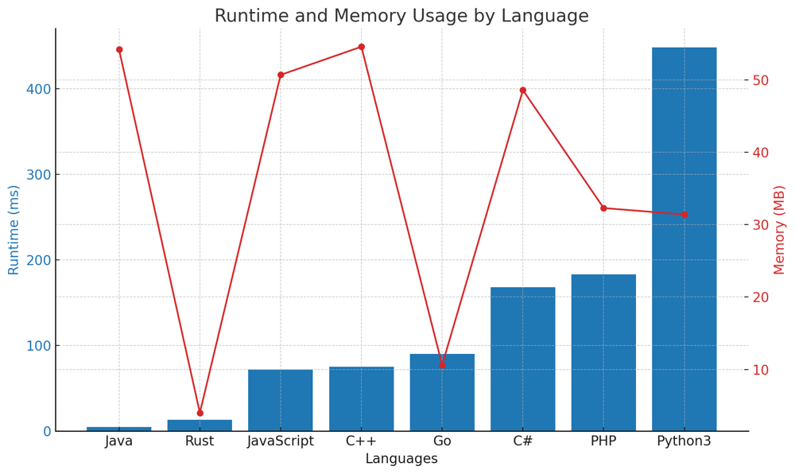

# ✅ 99.17% O(n) Greedy with Dynamic Upper Bound Adjustment

**Author:** vanAmsen
**Votes:** 47
**Link:** [https://leetcode.com/problems/minimum-replacements-to-sort-the-array/solutions/3978461/](https://leetcode.com/problems/minimum-replacements-to-sort-the-array/solutions/3978461/)

---

# Interview Guide - Minimum Replacements to Sort the Array: 

## Problem Understanding

**Description**:  
At its core, this problem is an intricate dance between array manipulation and greedy optimization. You're handed an integer array `nums` and given the ability to perform a unique, transformative operation: replace an element with two elements whose sum equals the original element. The goal is deceptively simple yet intriguing\u2014transform this array into a non-decreasing sequence while minimizing the number of these replacement operations.

## Key Points to Consider

### 1. Understand the Constraints
- Array length: $$1 \\leq \	ext{nums.length} \\leq 10^5$$
- Array elements: $$1 \\leq \	ext{nums[i]} \\leq 10^9$$
  
### 2. Focus on the Unusual
- The operation to replace a number with two numbers that sum to it is unusual but vital. Recognize that this operation allows us to control the 'granularity' of our array, breaking down larger numbers into more manageable, smaller ones.

### 3. Contextualizing the Greedy Approach
- The problem invites a greedy algorithm, not just as a means but as a strategic pathway. We work from right to left, maintaining a dynamic upper bound (`prev_bound`) that serves as our guiding star. This is crucial, as it enables us to make localized, optimal choices that contribute to a global optimum.

### 4. The Magic of Dynamic Upper Bound
- The concept of a dynamic upper bound (`prev_bound`) is key. As you move from the last element towards the first, this variable adapts to reflect the largest possible number you can place at the current position without requiring further replacements. It\u2019s like having an ever-changing speed limit that you must adhere to but want to get as close to as possible. 

### 5. Importance of Reverse Iteration
- Why do we iterate from the end? Because the last element acts as a natural, immutable upper bound. It sets the stage for the rest of the elements, offering an immediate reference for how small the preceding elements need to be.

### 6. Explain Your Thought Process
- The algorithm employs a greedy approach, iterating from the rightmost to the leftmost element. An upper bound (`prev_bound`) is maintained and updated dynamically as the algorithm progresses.
- For each element, the algorithm calculates how many times it should be divided (`no_of_times`) to maintain a non-decreasing order and minimize the number of operations.

---

# More than Live Coding:
https://youtu.be/c7NZJRt89dc?si=MP5lvbp9IbzczVKt

---

# Approach: Greedy Algorithm with Dynamic Upper Bound Adjustment

### Intuition and Logic Behind the Solution

The problem asks us to convert an array into a non-decreasing sorted array by replacing any element with two elements that sum to it. Essentially, we're breaking down larger numbers into smaller ones to sort the array.

#### The Trick

The trick lies in two observations:
1. The last element never needs to be replaced because any number can be broken down into smaller components.
2. The optimal strategy is to replace a number with smaller numbers that are as large as possible but still smaller than the preceding number. This ensures fewer replacements in subsequent steps.

#### Why Greedy?

The greedy approach comes into play when we decide which numbers to replace and how to replace them. We want to make sure that we replace as few numbers as possible and that the new numbers are as large as possible without being larger than the next number in the sorted sequence. This is why we initialize `prev_bound` with the last element of the array; it's the largest possible value we can get without needing to replace the last element.

### Step-by-step Explanation

#### Initialization
- We start by initializing an `operations` counter to zero. This will keep track of the minimum number of operations required.
- We also initialize `prev_bound` with the last element of the array, which serves as our dynamic upper bound for the current iteration.

#### Main Algorithm
1. **Iterate in Reverse**: We loop through the array in reverse order, skipping the last element.
    - **Calculate `no_of_times`**: For the current element (`num`), we calculate how many times it needs to be replaced in order to be smaller than or equal to `prev_bound`. The formula `(num + prev_bound - 1) // prev_bound` is a neat trick to handle both the cases when `num` is divisible by `prev_bound` and when it isn't.
    - **Update Operations**: We then increment the `operations` counter by `no_of_times - 1` (the `-1` is because one of the replaced numbers will occupy the original spot, so it's not a 'new' operation).
    - **Update `prev_bound`**: We set the new `prev_bound` as `num // no_of_times`. This ensures that in the next iteration, we are replacing numbers in the most optimal way possible.

#### Wrap-up
- Finally, the function returns the `operations` counter, which holds the minimum number of operations required to sort the array.

### Complexity Analysis
The time complexity is $$O(N)$$, where $$N$$ is the length of the array, because we traverse the array once. There's no additional space used, so the space complexity is $$O(1)$$.

---

# Performance

| Language   | Runtime (ms) | Memory (MB) |
|------------|--------------|-------------|
| Java       | 5            | 54.2        |
| Rust       | 13           | 4           |
| JavaScript | 72           | 50.7        |
| C++        | 75           | 54.6        |
| Go         | 90           | 10.6        |
| C#         | 168          | 48.6        |
| PHP        | 183          | 32.3        |
| Python3    | 448          | 31.4        |




# Code
``` Python []
class Solution:
    def minimumReplacement(self, nums: List[int]) -> int:
        operations = 0
        prev_bound = nums[-1]

        for num in reversed(nums[:-1]):
            no_of_times = (num + prev_bound - 1) // prev_bound
            operations += no_of_times - 1
            prev_bound = num // no_of_times
            
        return operations
```
``` C++ []
class Solution {
public:
    long long minimumReplacement(std::vector<int>& nums) {
        long long operations = 0;
        long long prev_bound = nums.back();
        
        for (auto it = nums.rbegin() + 1; it != nums.rend(); ++it) {
            long long num = *it;
            long long no_of_times = (num + prev_bound - 1) / prev_bound;
            operations += no_of_times - 1;
            prev_bound = num / no_of_times;
        }
        
        return operations;
    }
};
```
``` Rust []
impl Solution {
    pub fn minimum_replacement(nums: Vec<i32>) -> i64 {
        let mut operations: i64 = 0;
        let mut prev_bound: i64 = *nums.last().unwrap() as i64;
        
        for &num in nums.iter().rev().skip(1) {
            let num: i64 = num as i64;
            let no_of_times: i64 = (num + prev_bound - 1) / prev_bound;
            operations += no_of_times - 1;
            prev_bound = num / no_of_times;
        }
        
        operations
    }
}
```
``` Go []
func minimumReplacement(nums []int) int64 {
    var operations int64 = 0
    var prev_bound int64 = int64(nums[len(nums) - 1])
    
    for i := len(nums) - 2; i >= 0; i-- {
        var num int64 = int64(nums[i])
        var no_of_times int64 = (num + prev_bound - 1) / prev_bound
        operations += no_of_times - 1
        prev_bound = num / no_of_times
    }
    
    return operations
}
```
``` Java []
public class Solution {
    public long minimumReplacement(int[] nums) {
        long operations = 0;
        long prev_bound = nums[nums.length - 1];
        
        for (int i = nums.length - 2; i >= 0; i--) {
            long num = nums[i];
            long no_of_times = (num + prev_bound - 1) / prev_bound;
            operations += no_of_times - 1;
            prev_bound = num / no_of_times;
        }
        
        return operations;
    }
}
```
``` JavaScript []
/**
 * @param {number[]} nums
 * @return {number}
 */
var minimumReplacement = function(nums) {
    let operations = 0;
    let prev_bound = nums[nums.length - 1];
    
    for (let i = nums.length - 2; i >= 0; i--) {
        let num = nums[i];
        let no_of_times = Math.ceil(num / prev_bound);
        operations += no_of_times - 1;
        prev_bound = Math.floor(num / no_of_times);
    }
    
    return operations;
};
```
``` PHP []
class Solution {
    function minimumReplacement($nums) {
        $operations = 0;
        $prev_bound = end($nums);
        
        for ($i = count($nums) - 2; $i >= 0; $i--) {
            $num = $nums[$i];
            $no_of_times = intdiv($num + $prev_bound - 1, $prev_bound);
            $operations += $no_of_times - 1;
            $prev_bound = intdiv($num, $no_of_times);
        }
        
        return $operations;
    }
}
```
``` C# []
public class Solution {
    public long MinimumReplacement(int[] nums) {
        long operations = 0;
        long prev_bound = nums[^1];
        
        for (int i = nums.Length - 2; i >= 0; i--) {
            long num = nums[i];
            long no_of_times = (num + prev_bound - 1) / prev_bound;
            operations += no_of_times - 1;
            prev_bound = num / no_of_times;
        }
        
        return operations;
    }
}
```
Every line of code brings you one step closer to becoming an expert. Whether you value brevity or clarity, each approach has its merits. So jump in, explore, and don't hesitate to share your unique insights. Your perspective might be the key to someone else's breakthrough. Happy Coding! \uD83D\uDE80\uD83D\uDCA1\uD83C\uDF1F