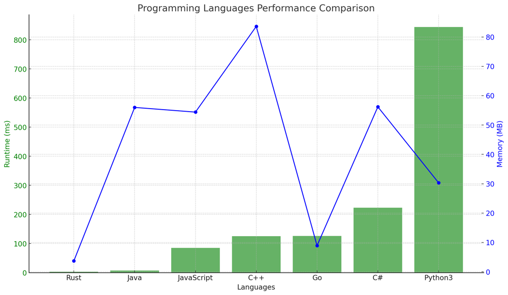

# ✅ 100% O(n) Dynamic Programming & Sliding Window [VIDEO] - Optimal Solution

**Author:** vanAmsen
**Votes:** 89
**Link:** [https://leetcode.com/problems/check-if-there-is-a-valid-partition-for-the-array/solutions/3901261/](https://leetcode.com/problems/check-if-there-is-a-valid-partition-for-the-array/solutions/3901261/)

---

# Problem Understanding

In the "Valid Partition" problem, we are provided with an array of integers. The objective is to determine if it's possible to partition the array into one or more contiguous subarrays that meet specific criteria. A partition is considered valid if each subarray formed satisfies at least one of the following conditions:

1. The subarray contains exactly 2 identical elements.
2. The subarray contains exactly 3 identical elements.
3. The subarray contains exactly 3 consecutive increasing elements.

The solution should return `True` if there's at least one valid partition, and `False` otherwise.

For instance, consider the array `nums = [1, 1, 2, 3, 4]`.

A valid partition would be the subarrays `[1, 1]` and `[2, 3, 4]`.

# Video Live Coding & Explenation

https://youtu.be/ESbbmQ9TPqY


- [Coding in Python \uD83D\uDC0D](https://youtu.be/ESbbmQ9TPqY)
- [Coding in Rust \uD83E\uDD80](https://youtu.be/MV-Zca7Unxo)

---

# Approach

## Dynamic Programming with Sliding Window

The core idea of this solution is to use a sliding window of size 3 to track the state of the current and the two previous numbers in the list. At each step, we determine the validity of the partition up to the current index.

## Key Data Structures:

- **`dp` Array**:
  The `dp` array is a list of 3 boolean values. The values in this list help track the validity of the partition up to the current index.
  - `dp[0]` represents the validity of the partition up to index `i-2`.
  - `dp[1]` represents the validity of the partition up to index `i-1`.
  - `dp[2]` represents the validity of the partition up to the current index `i`.

### Step-by-step Breakdown:

1. **Initialization**:
   - Check the base case where the list has only one element. In this scenario, we can't create any valid subarray, so we return `False`.
   - Initialize the `dp` array with the following values:
     - `dp[0]` is `True` because an empty list is always valid.
     - `dp[1]` is `False` initially.
     - `dp[2]` checks if the first two numbers are identical.

2. **Iterate through the List**:
   - Start iterating from the third element (`index = 2`).
   - For each number:
     - Check if it matches the previous one and if `dp[1]` is `True`, indicating a valid partition up to this point.
     - Check if it forms a triplet with the two preceding numbers that are identical and if `dp[0]` is `True`, maintaining the validity.
     - Check if the current and the two preceding numbers form a sequence of three consecutive increasing numbers, and if `dp[0]` is `True`, keeping the partition valid.
   - Slide the window forward by reassigning the values in the `dp` array.

3. **Result**:
   - After iterating through the entire list, `dp[2]` will reflect whether the list can be partitioned into valid subarrays.

## Example:

Consider the list `nums = [1, 1, 2, 3, 4]`.

Here's the evolution of the `dp` array:

**Initial State**:
- `dp`: [True, False, True]

**After processing index 2 (element = 2)**:
- `dp`: [False, True, True]

**After processing index 3 (element = 3)**:
- `dp`: [True, True, True]

**After processing index 4 (element = 4)**:
- `dp`: [True, True, True]

The final state of the `dp` array shows that the list can be validly partitioned into subarrays like `[1, 1]` and `[2, 3, 4]`.

# Complexity

**Time Complexity:** $$O(n)$$
Each element in the `nums` array is processed once, resulting in a linear time complexity.

**Space Complexity:** $$O(1)$$
The solution only uses a constant amount of space, irrespective of the size of the `nums` array.

# Performance

The solution is highly efficient. It quickly determines the validity of a partition by leveraging past computations, ensuring optimal runtime even for larger arrays. The minimal space requirement makes it memory-efficient as well.

Here's the performance table sorted by runtime (ms):

| Language   | Runtime (ms) | Runtime Beat (%) | Memory (MB) | Memory Beat (%) |
|------------|--------------|------------------|-------------|-----------------|
| **Rust**       | 3           | 100%             | 3.7         | 100%            |
| **Java**       | 7            | 82.52%           | 56          | 100%            |
| **JavaScript** | 85           | 85.71%           | 54.4        | 100%            |
| **C++**        | 125          | 91.38%           | 83.6        | 99.69%          |
| **Go**         | 126          | 85.71%           | 8.9         | 85.71%          |
| **C#**         | 223          | 100%             | 56.2        | 100%            |
| **Python3**    | 844          | 93.8%            | 30.3        | 90%             |




# Code
``` Python []
class Solution:
    def validPartition(self, nums: List[int]) -> bool:
        n = len(nums) 

        # If the array has only one element, then not possible to partition into valid subarrays 
        if n == 1: 
            return False 

        # Initialization for the first three values 
        dp = [True, False, nums[0] == nums[1] if n > 1 else False] 

        for i in range(2, n): 
            current_dp = False 

            # Check for 2 equal elements 
            if nums[i] == nums[i-1] and dp[1]: 
                current_dp = True 

            # Check for 3 equal elements 
            elif nums[i] == nums[i-1] == nums[i-2] and dp[0]: 
                current_dp = True 

            # Check for 3 consecutive increasing elements 
            elif nums[i] - nums[i-1] == 1 and nums[i-1] - nums[i-2] == 1 and dp[0]: 
                current_dp = True 

            # Move the window forward 
            dp[0], dp[1], dp[2] = dp[1], dp[2], current_dp 

        return dp[2]
```
``` C++ []
class Solution {
public:
    bool validPartition(std::vector<int>& nums) {
        int n = nums.size();

        if (n == 1) return false;

        std::vector<bool> dp = {true, false, n > 1 && nums[0] == nums[1]};

        for (int i = 2; i < n; i++) {
            bool current_dp = false;

            if (nums[i] == nums[i-1] && dp[1]) {
                current_dp = true;
            }
            else if (nums[i] == nums[i-1] && nums[i] == nums[i-2] && dp[0]) {
                current_dp = true;
            }
            else if (nums[i] - nums[i-1] == 1 && nums[i-1] - nums[i-2] == 1 && dp[0]) {
                current_dp = true;
            }

            dp[0] = dp[1];
            dp[1] = dp[2];
            dp[2] = current_dp;
        }

        return dp[2];
    }
};
```
``` Go []
func validPartition(nums []int) bool {
    n := len(nums)

    if n == 1 {
        return false
    }

    dp := []bool{true, false, n > 1 && nums[0] == nums[1]}

    for i := 2; i < n; i++ {
        current_dp := false

        if nums[i] == nums[i-1] && dp[1] {
            current_dp = true
        } else if nums[i] == nums[i-1] && nums[i] == nums[i-2] && dp[0] {
            current_dp = true
        } else if nums[i] - nums[i-1] == 1 && nums[i-1] - nums[i-2] == 1 && dp[0] {
            current_dp = true
        }

        dp[0], dp[1], dp[2] = dp[1], dp[2], current_dp
    }

    return dp[2]
}
```
``` Rust []
impl Solution {
    pub fn valid_partition(nums: Vec<i32>) -> bool {
        let n = nums.len();

        if n == 1 {
            return false;
        }

        let mut dp = vec![true, false, if n > 1 { nums[0] == nums[1] } else { false }];

        for i in 2..n {
            let mut current_dp = false;

            if nums[i] == nums[i-1] && dp[1] {
                current_dp = true;
            }
            else if nums[i] == nums[i-1] && nums[i] == nums[i-2] && dp[0] {
                current_dp = true;
            }
            else if nums[i] - nums[i-1] == 1 && nums[i-1] - nums[i-2] == 1 && dp[0] {
                current_dp = true;
            }

            dp[0] = dp[1];
            dp[1] = dp[2];
            dp[2] = current_dp;
        }

        dp[2]
    }
}
```
``` Java []
public class Solution {
    public boolean validPartition(int[] nums) {
        int n = nums.length;

        if (n == 1) return false;

        boolean[] dp = new boolean[]{true, false, n > 1 && nums[0] == nums[1]};

        for (int i = 2; i < n; i++) {
            boolean current_dp = false;

            if (nums[i] == nums[i-1] && dp[1]) {
                current_dp = true;
            }
            else if (nums[i] == nums[i-1] && nums[i] == nums[i-2] && dp[0]) {
                current_dp = true;
            }
            else if (nums[i] - nums[i-1] == 1 && nums[i-1] - nums[i-2] == 1 && dp[0]) {
                current_dp = true;
            }

            dp[0] = dp[1];
            dp[1] = dp[2];
            dp[2] = current_dp;
        }

        return dp[2];
    }
}
```
``` JavaScript []
/**
 * @param {number[]} nums
 * @return {boolean}
 */
var validPartition = function(nums) {
    let n = nums.length;

    if (n === 1) return false;

    let dp = [true, false, n > 1 && nums[0] === nums[1]];

    for (let i = 2; i < n; i++) {
        let current_dp = false;

        if (nums[i] === nums[i-1] && dp[1]) {
            current_dp = true;
        }
        else if (nums[i] === nums[i-1] && nums[i] === nums[i-2] && dp[0]) {
            current_dp = true;
        }
        else if (nums[i] - nums[i-1] === 1 && nums[i-1] - nums[i-2] === 1 && dp[0]) {
            current_dp = true;
        }

        [dp[0], dp[1], dp[2]] = [dp[1], dp[2], current_dp];
    }

    return dp[2];
};
```
``` C# []
public class Solution {
    public bool ValidPartition(int[] nums) {
        int n = nums.Length;

        if (n == 1) return false;

        bool[] dp = new bool[]{true, false, n > 1 && nums[0] == nums[1]};

        for (int i = 2; i < n; i++) {
            bool current_dp = false;

            if (nums[i] == nums[i-1] && dp[1]) {
                current_dp = true;
            }
            else if (nums[i] == nums[i-1] && nums[i] == nums[i-2] && dp[0]) {
                current_dp = true;
            }
            else if (nums[i] - nums[i-1] == 1 && nums[i-1] - nums[i-2] == 1 && dp[0]) {
                current_dp = true;
            }

            dp[0] = dp[1];
            dp[1] = dp[2];
            dp[2] = current_dp;
        }

        return dp[2];
    }
}
```

# Code - Combine True
``` Python []
class Solution:
    def validPartition(self, nums: List[int]) -> bool:
        n = len(nums) 
        if n == 1: 
            return False 
        dp = [True, False, nums[0] == nums[1] if n > 1 else False] 
        for i in range(2, n): 
            current_dp = (nums[i] == nums[i-1] and dp[1]) or \\
                         (nums[i] == nums[i-1] == nums[i-2] and dp[0]) or \\
                         (nums[i] - nums[i-1] == 1 and nums[i-1] - nums[i-2] == 1 and dp[0])
            dp[0], dp[1], dp[2] = dp[1], dp[2], current_dp 
        return dp[2]
```
``` C++ []
class Solution {
public:
    bool validPartition(vector<int>& nums) {
        int n = nums.size();
        if (n == 1) return false;
        vector<bool> dp = {true, false, n > 1 ? nums[0] == nums[1] : false};
        for (int i = 2; i < n; i++) {
            bool current_dp = (nums[i] == nums[i-1] && dp[1]) || 
                              (nums[i] == nums[i-1] && nums[i] == nums[i-2] && dp[0]) ||
                              (nums[i] - nums[i-1] == 1 && nums[i-1] - nums[i-2] == 1 && dp[0]);
            dp[0] = dp[1];
            dp[1] = dp[2];
            dp[2] = current_dp;
        }
        return dp[2];
    }
};
```
``` Rust []
impl Solution {
    pub fn valid_partition(nums: Vec<i32>) -> bool {
        let n = nums.len();
        if n == 1 { return false; }
        let mut dp = vec![true, false, if n > 1 { nums[0] == nums[1] } else { false }];
        for i in 2..n {
            let current_dp = (nums[i] == nums[i-1] && dp[1]) || 
                             (nums[i] == nums[i-1] && nums[i] == nums[i-2] && dp[0]) ||
                             (nums[i] - nums[i-1] == 1 && nums[i-1] - nums[i-2] == 1 && dp[0]);
            dp[0] = dp[1];
            dp[1] = dp[2];
            dp[2] = current_dp;
        }
        dp[2]
    }
}
```
``` Go []
func validPartition(nums []int) bool {
    n := len(nums)
    if n == 1 { return false }
    dp := []bool{true, false, false}
    if n > 1 {
        dp[2] = nums[0] == nums[1]
    }
    for i := 2; i < n; i++ {
        current_dp := (nums[i] == nums[i-1] && dp[1]) || 
                      (nums[i] == nums[i-1] && nums[i] == nums[i-2] && dp[0]) ||
                      (nums[i] - nums[i-1] == 1 && nums[i-1] - nums[i-2] == 1 && dp[0])
        dp[0], dp[1], dp[2] = dp[1], dp[2], current_dp
    }
    return dp[2]
}
```
``` Java []
public class Solution {
    public boolean validPartition(int[] nums) {
        int n = nums.length;
        if (n == 1) return false;
        boolean[] dp = {true, false, n > 1 ? nums[0] == nums[1] : false};
        for (int i = 2; i < n; i++) {
            boolean current_dp = (nums[i] == nums[i-1] && dp[1]) || 
                                 (nums[i] == nums[i-1] && nums[i] == nums[i-2] && dp[0]) ||
                                 (nums[i] - nums[i-1] == 1 && nums[i-1] - nums[i-2] == 1 && dp[0]);
            dp[0] = dp[1];
            dp[1] = dp[2];
            dp[2] = current_dp;
        }
        return dp[2];
    }
}
```
``` C# []
public class Solution {
    public bool ValidPartition(int[] nums) {
        int n = nums.Length;
        if (n == 1) return false;
        bool[] dp = {true, false, n > 1 ? nums[0] == nums[1] : false};
        for (int i = 2; i < n; i++) {
            bool current_dp = (nums[i] == nums[i-1] && dp[1]) || 
                              (nums[i] == nums[i-1] && nums[i] == nums[i-2] && dp[0]) ||
                              (nums[i] - nums[i-1] == 1 && nums[i-1] - nums[i-2] == 1 && dp[0]);
            dp[0] = dp[1];
            dp[1] = dp[2];
            dp[2] = current_dp;
        }
        return dp[2];
    }
}
```
``` JavaScript []
/**
 * @param {number[]} nums
 * @return {boolean}
 */
var validPartition = function(nums) {
    let n = nums.length;
    if (n === 1) return false;
    let dp = [true, false, n > 1 ? nums[0] === nums[1] : false];
    for (let i = 2; i < n; i++) {
        let current_dp = (nums[i] === nums[i-1] && dp[1]) || 
                         (nums[i] === nums[i-1] && nums[i] === nums[i-2] && dp[0]) ||
                         (nums[i] - nums[i-1] === 1 && nums[i-1] - nums[i-2] === 1 && dp[0]);
        dp[0] = dp[1];
        dp[1] = dp[2];
        dp[2] = current_dp;
    }
    return dp[2];
};
```
By using the logical or operator, we're able to combine all the conditions that result in a True value for current_dp. This makes the code more concise.

# Live Coding in Rust

https://youtu.be/MV-Zca7Unxo