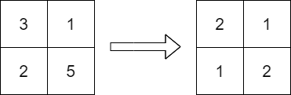

# [2371. Minimize Maximum Value in a Grid](https://leetcode.com/problems/minimize-maximum-value-in-a-grid/)

| Category | Difficulty | Likes | Dislikes |
| :------: | :--------: | :---: | :------: |
| Algorithms | Hard | 143 | 6 |

**Tags:** [`array`](https://leetcode.com/tag/array), [`union-find`](https://leetcode.com/tag/union-find), [`graph`](https://leetcode.com/tag/graph), [`topological-sort`](https://leetcode.com/tag/topological-sort), [`sorting`](https://leetcode.com/tag/sorting), [`matrix`](https://leetcode.com/tag/matrix)

**Companies:** `google`

## Description

You are given an `m x n` integer matrix `grid` containing **distinct** positive integers.

You have to replace each integer in the matrix with a positive integer satisfying the following conditions:

	- The **relative** order of every two elements that are in the same row or column should stay the **same** after the replacements.

	- The **maximum** number in the matrix after the replacements should be as **small** as possible.

The relative order stays the same if for all pairs of elements in the original matrix such that `grid[r_1][c_1] > grid[r_2][c_2]` where either `r_1 == r_2` or `c_1 == c_2`, then it must be true that `grid[r_1][c_1] > grid[r_2][c_2]` after the replacements.

For example, if `grid = [[2, 4, 5], [7, 3, 9]]` then a good replacement could be either `grid = [[1, 2, 3], [2, 1, 4]]` or `grid = [[1, 2, 3], [3, 1, 4]]`.

Return *the **resulting** matrix.* If there are multiple answers, return **any** of them.

 

**Example 1:**


```

Input: grid = [[3,1],[2,5]]
Output: [[2,1],[1,2]]
Explanation: The above diagram shows a valid replacement.
The maximum number in the matrix is 2. It can be shown that no smaller value can be obtained.

```

**Example 2:**

```

Input: grid = [[10]]
Output: [[1]]
Explanation: We replace the only number in the matrix with 1.

```

 

**Constraints:**

	- `m == grid.length`

	- `n == grid[i].length`

	- `1 <= m, n <= 1000`

	- `1 <= m * n <= 10^5`

	- `1 <= grid[i][j] <= 10^9`

	- `grid` consists of distinct integers.

---

**Links:** [Submissions](https://leetcode.com/problems/minimize-maximum-value-in-a-grid/) | [Solutions](https://leetcode.com/problems/minimize-maximum-value-in-a-grid/)
