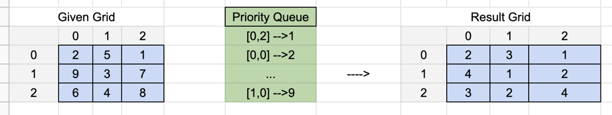
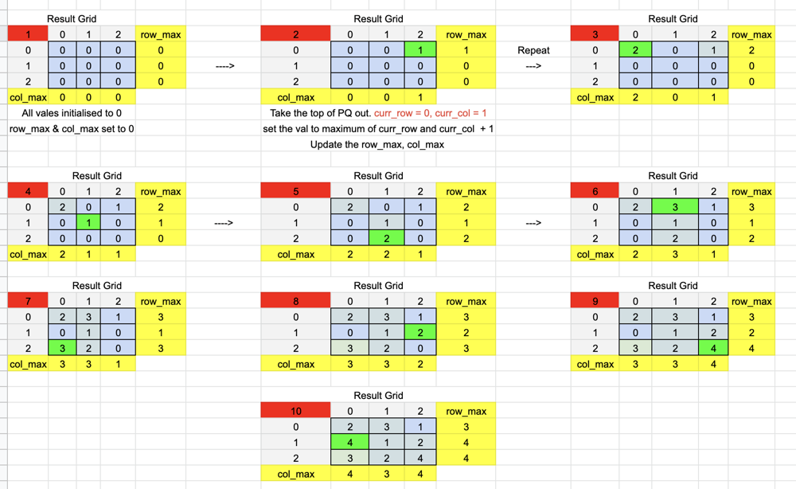

# Java :: Explained with pictures - Priority Queue | O(mn log(mn)) - ttt

**Author:** harsh_ju_sharma
**Votes:** 48
**Link:** [https://leetcode.com/problems/minimize-maximum-value-in-a-grid/solutions/2413832/](https://leetcode.com/problems/minimize-maximum-value-in-a-grid/solutions/2413832/)

---

**Observations**
* The elements of the grid are distinct
* We need to make changes such that *the max element in the grid is minimised*
* The relative order needs to be kept intact for each pair in the same row ans col

**Idea**
* The 1st thought is to sort row and col wise and starting from the smallest, put values from 1, 2.... in the row and col
* However, that wont be the optimal solution as the result matrix element does not need to be distinct
* In stead, we maintain a matrix for rows and cols to *store the max values in each row and col*
* Hence, the new val for cell will be the next possible value, i.e **the max (max of that row, max of that col) + 1**
* A Priority Queue is used to store the indices in order as shown below

Explaining the above logic in words is quite a challenge, hence here is a simulation for the algorithm. Hope it makes sense.

**Let's look at a sample test case**



**Simulation to reach the result matrix**


```
class Solution {
    public int[][] minScore(int[][] A) {
        int rows = A.length, cols = A[0].length;
        PriorityQueue<int[]> pq = new PriorityQueue<>((a,b) -> A[a[0]][a[1]] - A[b[0]][b[1]]);
        
        for(int i = 0; i < rows; i++){
            for(int j = 0; j < cols; j++){
                pq.offer(new int[]{i, j});
            }
        }
        
        int[] row_max = new int[rows], col_max = new int[cols];
        int[][] res = new int[rows][cols];
        
        while(pq.size() > 0){
            int[] curr = pq.poll();
            
            int curr_row = curr[0], curr_col = curr[1];
            
            int val = Math.max(row_max[curr_row], col_max[curr_col]) + 1;
            res[curr_row][curr_col] = val;
            row_max[curr_row] = val;
            col_max[curr_col] = val;
        }
        
        return res;
    }
}
```

```
Time complexity: O(m*n* log(mn))

~~ as we traverse all the elements in the matrix, that costs us m*n time, 
and for each element, we make an entry in the PQ,
which will cost is log(size of PQ) each time. 
Also, max size of PQ = m*n

Here, m = #rows, n = #cols

Space Complexity: O(m*n)
```

**Similar Problems**
[1632. Rank Transform of a Matrix](https://leetcode.com/problems/rank-transform-of-a-matrix/)