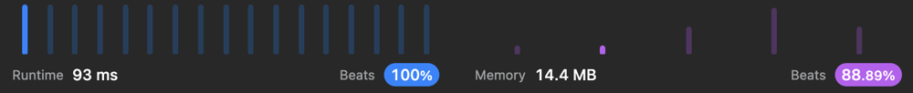

# ✅ [Swift] Two loops, 100% speed , easy to understand

**Author:** lmvtsv
**Votes:** 5
**Link:** [https://leetcode.com/problems/largest-local-values-in-a-matrix/solutions/2851644/](https://leetcode.com/problems/largest-local-values-in-a-matrix/solutions/2851644/)

---



```
class Solution {
    func largestLocal(_ grid: [[Int]]) -> [[Int]] {
        var size = grid.count - 2
	    var result = Array(repeating: Array(repeating: 0, count: size), count: size)

	    for i in 0..<size {
		    for j in 0..<size {
			    var maxLocal = max(grid[i][j], grid[i][j + 1], grid[i][j + 2])
			    maxLocal = max(maxLocal, grid[i + 1][j], grid[i + 1][j + 1], grid[i + 1][j + 2])
			    maxLocal = max(maxLocal, grid[i + 2][j], grid[i + 2][j + 1], grid[i + 2][j + 2])
			    result[i][j] = maxLocal
		    }
	    }
	    return result
    }
}
```