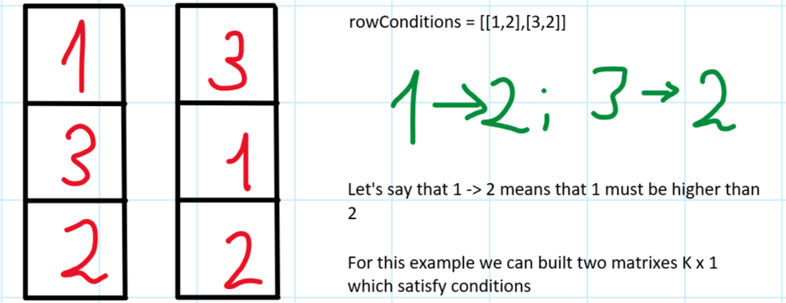
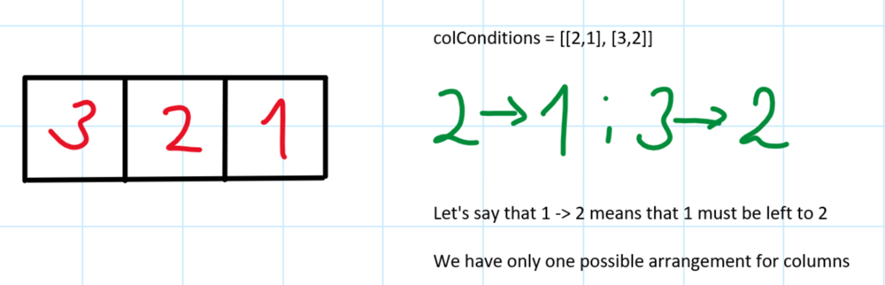
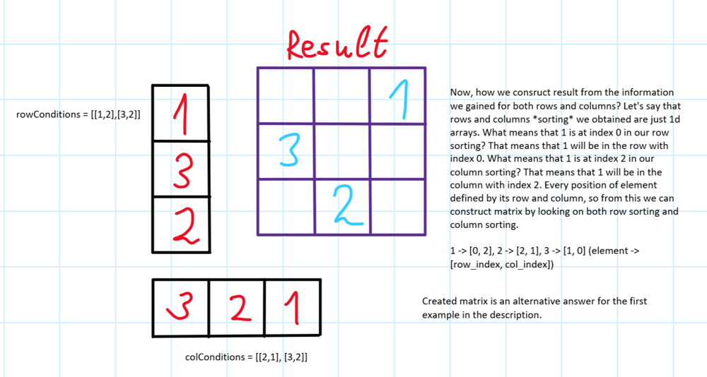
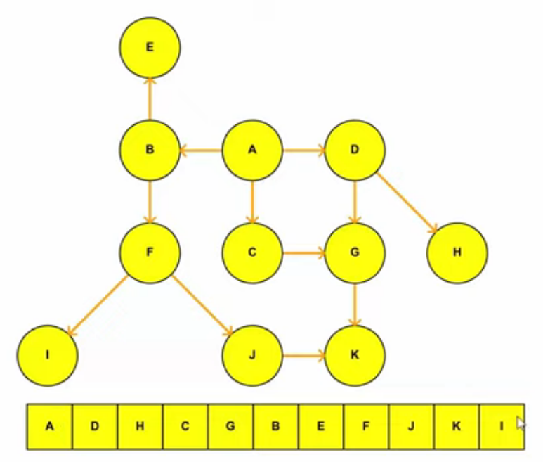
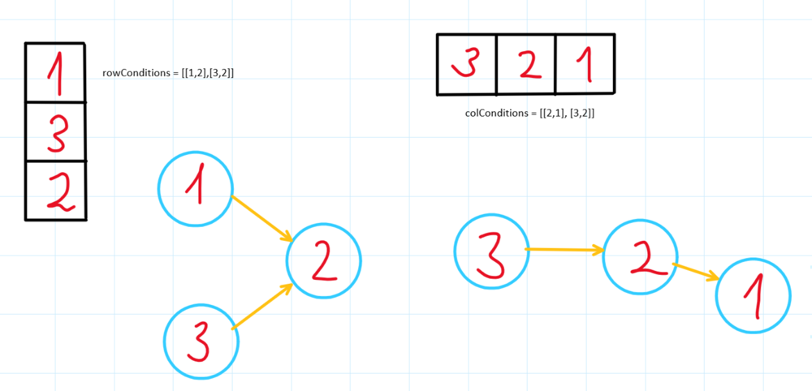
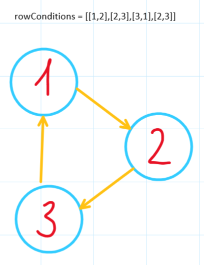

# ✅💯🔥Explanations No One Will Give You🎓🧠VERY Detailed Approach🎯🔥Extremely Simple And Effective🔥

**Author:** heir-of-god
**Votes:** 131
**Link:** [https://leetcode.com/problems/build-a-matrix-with-conditions/solutions/5510063/](https://leetcode.com/problems/build-a-matrix-with-conditions/solutions/5510063/)

---


<blockquote>
        <p>
            <b>
                I am lucky that whatever fear I have inside me, my desire to win is always stronger.
            </b>        
        </p>
        <p>
            --- Serena Williams ---
        </p>
</blockquote>

# \uD83D\uDC51Problem Explanation and Understanding:

## \uD83C\uDFAF Problem Description
You are given an integer `k` and two 2d arrays `rowConditions` and `colConditions`. You need to create 2d matrix with sizes `k x k` where there's exactly k numbers from 1 to k and all other elements are 0. Elements in `rowConditions` and `colConditions` - arrays with 2 elements which just mean: `rowCondition[0] must be in a row ABOVE rowCondition[1]` and `colCondition[0] must be in a column LEFT to colCondition[1]`.

## \uD83D\uDCE5\u2935\uFE0F Input:
- Integer `k` representing sizes of the matrix
- Integer 2d array `rowConditions` representing conditions for rows
- Integer 2d array `colConditions` representing conditions for columns

## \uD83D\uDCE4\u2934\uFE0F Output:
The valid matrix you created OR the empty array if such matrix doesn't exist

---

# 1\uFE0F\u20E3\uD83C\uDFC6 Approach: Topological Sorting With DFS

# \uD83E\uDD14 Intuition
**First of all - graphs is hard**. Okay, now forget about the graphs and let me explain how to think about this problem. 
- Let's make problem easier for us, what if we will consider only `rowConditions` and for a second forget about `colConditions`? Like imagine we have matrix `K x 1` so all we need to do is place numbers correctly according to row ordering in `rowConditions`. Let's say somehow we created this matrixes (now this doesn't matter how, because you want to understand the logic of the problem)



- Okay, good, we know in which row every element will go, but what about columns? We want columns also to be *sorted* with `colConditions`. Can we do the same thing we did to rows? Absolutely, let's do this.



- Let's say now we have correct orders for both rows and columns, we know for sure in which row element must be and in which column, can we now esaily construct matrix with this? Sure



- In fact, this is the whole logic for this problem. But let's think about some edge cases and implementing details.
- First of all - we created these sortings for rows and columns by magic in the example but in fact behind this approach is algorithm *Topological Sorting*. Topological sorting - graph algorithm for directed graphs without cycles which just sort graph vertixes in manner `first comes my prerequisites (parents) then I come myself and only then come my childrens`

This is an example for topological sorting ([source](https://youtu.be/7J3GadLzydI?si=zpZ_A8oLRSNkGql4))



The sequence created above is just one of the possible sorting. Topological sort isn't unique which means that there can be multiple answers for one graph. 

- How we will apply topological sort to our problem? Well, look at the my pictures above where I've drawn relations between values as arrows. In fact, we can imagine for both rows and columns conditions as graph where given to us `rowConditions` and `colConditions` are edges for graph. This will look like this:



And now if you think about topological sorting of the row graph you will see that in fact there's actually two possible sorting.

- The one edge case I want to consider before we move on to the code - when there will be the case where matrix is impossible to create? Well, let's look on one more example from the description:



Do you see the problem? When I was explaining topological sorting I mentioned that it works only for graphs with no cycle (Acyclic) but there's actually the cycle and also logic drawback if you think about it - 1 must be higher than 2, 2 must be higher than 3 (so this can be [1, 2, 3]) but now what?.... 3 must be higher than 1 which is impossible because of previous conditions.

Hope this all makes sense - if not or you have any doubts feel free to ask questions in the comments!\u2764\uFE0F

# \uD83D\uDC69\uD83C\uDFFB\u200D\uD83D\uDCBB Coding 
- Define a nested helper function `dfs` for depth-first search:
  - `dfs` takes five arguments: `src` (current node), `graph` (adjacency list), `visited` (set of visited nodes), `cur_path` (current path nodes), and `res` (result list).
  - Return `False` if a cycle is detected (node is in `cur_path`) and `True` otherwise.
  - Mark the node as visited and add it to the current path.
  - Recursively call `dfs` for each neighbor; if any call returns `False`, return `False`.
  - Backtrack by removing the node from the current path and add it to the result list. (so last nodes visited will be first at list, that's why we reverse list in topo_sort)

- Define another helper function `topo_sort` for topological sorting:
  - `topo_sort` takes `edges` (list of edges) as input.
  - Build an adjacency list `graph` from the edges.
  - Initialize `visited` and `cur_path` as empty sets, and `res` as an empty list.
  - Perform DFS on all nodes from 1 to `k` using the `dfs` function.
  - Return an empty list if a cycle is detected, otherwise return the result list reversed.

- Perform topological sorting on `rowConditions` and `colConditions` using `topo_sort` and store the results in `row_sorting` and `col_sorting`.
- If either sorting result is an empty list (there was a cycle), return an empty list.
- Create a dictionary `value_position` to store the row and column indices for each value from 1 to `k`.
- Assign row indices to the values based on `row_sorting`.
- Assign column indices to the values based on `col_sorting`.
- Initialize the result matrix `res` as a `k x k` matrix filled with zeros.
- Populate the matrix `res` using the positions from `value_position`.
- Return the populated matrix `res`.

# \uD83D\uDCD5 Complexity Analysis
- \u23F0 Time complexity: O(k), since you will run 2 dfs on `k` nodes and visit each exactly once -> O(2k) -> O(k) (You can also consider O(k^2) since you're created matrix k x k but there's no way to return matrix without creating it, so this doesn't make sense)
- \uD83E\uDDFA Space complexity: O(k), since we use several data structures like arrays and hashmaps with size up to `k` and there's dfs call stack which is also linear for `k`

# \uD83D\uDCBB Code (I've saved comments for each language)
``` python []
class Solution:
    def buildMatrix(self, k: int, rowConditions: list[list[int]], colConditions: list[list[int]]) -> list[list[int]]:
        # return True if all okay and return False if cycle was found
        def dfs(src, graph, visited, cur_path, res) -> bool:
            if src in cur_path:
                return False  # cycle detected

            if src in visited:
                return True  # all okay, but we've already visited this node

            visited.add(src)
            cur_path.add(src)

            for neighbor in graph[src]:
                if not dfs(neighbor, graph, visited, cur_path, res):  # if any child returns false
                    return False

            cur_path.remove(src)  # backtrack path
            res.append(src)
            return True

        # if there will be cycle - return empty array, in other case return 1d array as described above
        def topo_sort(edges) -> list[int]:
            graph = defaultdict(list)
            for src, dst in edges:
                graph[src].append(dst)

            visited: set[int] = set()
            cur_path: set[int] = set()
            res: list[int] = []

            for src in range(1, k + 1, 1):
                if not dfs(src, graph, visited, cur_path, res):
                    return []

            return res[::-1]  # we will have res as reversed so we need to reverse it one more time

        row_sorting: list[int] = topo_sort(rowConditions)
        col_sorting: list[int] = topo_sort(colConditions)
        if [] in (row_sorting, col_sorting):
            return []

        value_position: dict[int, list[int]] = {
            n: [0, 0] for n in range(1, k + 1, 1)
        }  # element -> [row_index, col_index]
        for ind, val in enumerate(row_sorting):
            value_position[val][0] = ind
        for ind, val in enumerate(col_sorting):
            value_position[val][1] = ind

        res: list[list[int]] = [[0 for _ in range(k)] for _ in range(k)]
        for value in range(1, k + 1, 1):
            row, column = value_position[value]
            res[row][column] = value

        return res
```
``` C++ []
class Solution {
public:
    vector<vector<int>> buildMatrix(int k, vector<vector<int>>& rowConditions, vector<vector<int>>& colConditions) {
        unordered_map<int, vector<int>> graph;
        for (const auto& edge : rowConditions) {
            graph[edge[0]].push_back(edge[1]);
        }

        vector<int> row_sorting = topo_sort(graph, k);
        graph.clear();
        for (const auto& edge : colConditions) {
            graph[edge[0]].push_back(edge[1]);
        }
        vector<int> col_sorting = topo_sort(graph, k);

        if (row_sorting.empty() || col_sorting.empty()) {
            return {};
        }

        unordered_map<int, pair<int, int>> value_position;
        for (int i = 0; i < k; ++i) {
            value_position[row_sorting[i]].first = i;
            value_position[col_sorting[i]].second = i;
        }

        vector<vector<int>> res(k, vector<int>(k, 0));
        for (int value = 1; value <= k; ++value) {
            int row = value_position[value].first;
            int column = value_position[value].second;
            res[row][column] = value;
        }

        return res;
    }

private:
    bool dfs(int src, unordered_map<int, vector<int>>& graph, unordered_set<int>& visited, unordered_set<int>& cur_path, vector<int>& res) {
        if (cur_path.count(src)) return false;  // cycle detected
        if (visited.count(src)) return true;  // all okay, but we've already visited this node

        visited.insert(src);
        cur_path.insert(src);

        for (int neighbor : graph[src]) {
            if (!dfs(neighbor, graph, visited, cur_path, res))  // if any child returns false
                return false;
        }

        cur_path.erase(src);  // backtrack path
        res.push_back(src);
        return true;
    }

    vector<int> topo_sort(unordered_map<int, vector<int>>& graph, int k) {
        unordered_set<int> visited;
        unordered_set<int> cur_path;
        vector<int> res;

        for (int src = 1; src <= k; ++src) {
            if (!dfs(src, graph, visited, cur_path, res))
                return {};
        }

        reverse(res.begin(), res.end());  // we will have res as reversed so we need to reverse it one more time
        return res;
    }
};
```
``` JavaScript []
var buildMatrix = function(k, rowConditions, colConditions) {
    // return True if all okay and return False if cycle was found
    function dfs(src, graph, visited, cur_path, res) {
        if (cur_path.has(src)) return false;  // cycle detected
        if (visited.has(src)) return true;  // all okay, but we've already visited this node

        visited.add(src);
        cur_path.add(src);

        for (let neighbor of (graph.get(src) || [])) {
            if (!dfs(neighbor, graph, visited, cur_path, res))  // if any child returns false
                return false;
        }

        cur_path.delete(src);  // backtrack path
        res.push(src);
        return true;
    }

    // if there will be cycle - return empty array, in other case return 1d array as described above
    function topo_sort(edges) {
        let graph = new Map();
        for (let [src, dst] of edges) {
            if (!graph.has(src)) graph.set(src, []);
            graph.get(src).push(dst);
        }

        let visited = new Set();
        let cur_path = new Set();
        let res = [];

        for (let src = 1; src <= k; ++src) {
            if (!dfs(src, graph, visited, cur_path, res))
                return [];
        }

        return res.reverse();  // we will have res as reversed so we need to reverse it one more time
    }

    let row_sorting = topo_sort(rowConditions);
    let col_sorting = topo_sort(colConditions);
    if (!row_sorting.length || !col_sorting.length)
        return [];

    let value_position = {};
    for (let n = 1; n <= k; ++n) {
        value_position[n] = [0, 0];  // element -> [row_index, col_index]
    }
    row_sorting.forEach((val, ind) => value_position[val][0] = ind);
    col_sorting.forEach((val, ind) => value_position[val][1] = ind);

    let res = Array.from({ length: k }, () => Array(k).fill(0));
    for (let value = 1; value <= k; ++value) {
        let [row, column] = value_position[value];
        res[row][column] = value;
    }

    return res;
};
```
``` Java []
class Solution {
    public int[][] buildMatrix(int k, int[][] rowConditions, int[][] colConditions) {
        List<Integer> row_sorting = topo_sort(rowConditions, k);
        List<Integer> col_sorting = topo_sort(colConditions, k);
        if (row_sorting.isEmpty() || col_sorting.isEmpty())
            return new int[0][0];

        Map<Integer, int[]> value_position = new HashMap<>();
        for (int n = 1; n <= k; ++n) {
            value_position.put(n, new int[2]);  // element -> [row_index, col_index]
        }
        for (int ind = 0; ind < row_sorting.size(); ++ind) {
            value_position.get(row_sorting.get(ind))[0] = ind;
        }
        for (int ind = 0; ind < col_sorting.size(); ++ind) {
            value_position.get(col_sorting.get(ind))[1] = ind;
        }

        int[][] res = new int[k][k];
        for (int value = 1; value <= k; ++value) {
            int row = value_position.get(value)[0];
            int column = value_position.get(value)[1];
            res[row][column] = value;
        }

        return res;
    }

    // return True if all okay and return False if cycle was found
    private boolean dfs(int src, Map<Integer, List<Integer>> graph, Set<Integer> visited, Set<Integer> cur_path, List<Integer> res) {
        if (cur_path.contains(src)) return false;  // cycle detected
        if (visited.contains(src)) return true;  // all okay, but we've already visited this node

        visited.add(src);
        cur_path.add(src);

        for (int neighbor : graph.getOrDefault(src, Collections.emptyList())) {
            if (!dfs(neighbor, graph, visited, cur_path, res))  // if any child returns false
                return false;
        }

        cur_path.remove(src);  // backtrack path
        res.add(src);
        return true;
    }

    // if there will be cycle - return empty array, in other case return 1d array as described above
    private List<Integer> topo_sort(int[][] edges, int k) {
        Map<Integer, List<Integer>> graph = new HashMap<>();
        for (int[] edge : edges) {
            graph.computeIfAbsent(edge[0], x -> new ArrayList<>()).add(edge[1]);
        }

        Set<Integer> visited = new HashSet<>();
        Set<Integer> cur_path = new HashSet<>();
        List<Integer> res = new ArrayList<>();

        for (int src = 1; src <= k; ++src) {
            if (!dfs(src, graph, visited, cur_path, res))
                return Collections.emptyList();
        }

        Collections.reverse(res);  // we will have res as reversed so we need to reverse it one more time
        return res;
    }
}
```

## \uD83D\uDCA1\uD83D\uDCA1\uD83D\uDCA1I encourage you to check out [my profile](https://leetcode.com/heir-of-god/) and [Project-S](https://github.com/Heir-of-God/Project-S) project for detailed explanations and code for different problems (not only Leetcode). Happy coding and learning!\uD83D\uDCDA

### Please consider *upvote*\u2B06\uFE0F\u2B06\uFE0F\u2B06\uFE0F because I try really hard not just to put here my code and rewrite testcase to show that it works but explain you WHY it works and HOW. Thank you\u2764\uFE0F

## If you have any doubts or questions feel free to ask them in comments. I will be glad to help you with understanding\u2764\uFE0F\u2764\uFE0F\u2764\uFE0F


