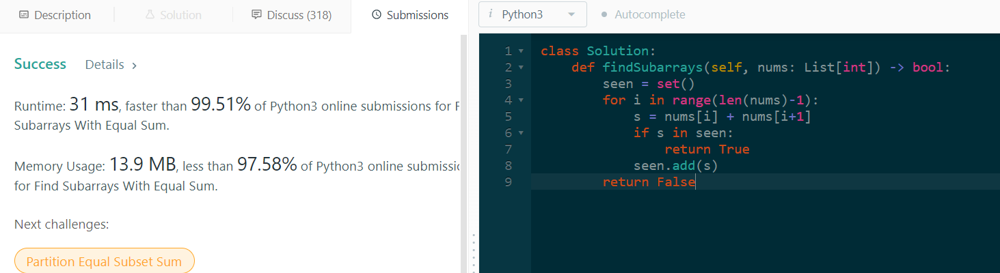

# Python | 99% Faster |  Easy Solution✅

**Author:** gmanayath
**Votes:** 12
**Link:** [https://leetcode.com/problems/find-subarrays-with-equal-sum/solutions/2544777/](https://leetcode.com/problems/find-subarrays-with-equal-sum/solutions/2544777/)

---

```
def findSubarrays(self, nums: List[int]) -> bool:
        seen = set()
        for i in range(len(nums)-1):
            s = nums[i] + nums[i+1]
            if s in seen:
                return True
            seen.add(s)
        return False
```

