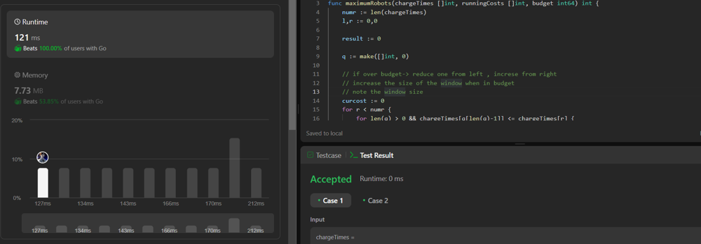

# Golang Solution Sliding Window + queue

**Author:** debasishfairytail
**Votes:** 0
**Link:** [https://leetcode.com/problems/maximum-number-of-robots-within-budget/solutions/4906174/](https://leetcode.com/problems/maximum-number-of-robots-within-budget/solutions/4906174/)

---

# Intuition
Method -> Sliding Window

To solve this within expected time limits we need to optimise the following. 
- Max function to find Maximim value within the pointer range
- Sum of array

# Approaches

#### Finding maximum 
Implement a queue `q`, 
Everytime we enter back into the loop, we also have a loop that removes elements from the end of queue `q` while their corresponding charge times are less than or equal to the charge time of the current robot (`chargeTimes[r]`). 
This loop ensures that the queue `q` contains only the indices of robots with strictly decreasing charge times.

When window is moved, we also drop the elements from he start.

So now to get Max() we need to get `chargeTimes[q[0]]`. 

The max function in this case was optimised to $$O(1)$$ operation

#### Finding sum
Keep track of a variable `curcost`, Add the running Cost as new elements are added.
When the Window is moved, Remove the running Cost of skipped element.

The sum in this case was optimised to $$O(1)$$ operation as well.


# Code
```


func maximumRobots(chargeTimes []int, runningCosts []int, budget int64) int {
    numr := len(chargeTimes)
    l,r := 0,0

    result := 0

    q := make([]int, 0)

    // if over budget-> reduce one from left , increse from right
    // increase the size of the window when in budget
    // note the window size
    curcost := 0
    for r < numr {
        for len(q) > 0 && chargeTimes[q[len(q)-1]] <= chargeTimes[r] {
            q = q[:len(q)-1]
        }
        curcost += runningCosts[r]
        q = append(q, r)
        c := int64(chargeTimes[q[0]] + ((r-l+1)*curcost))
        if c > budget {
            curcost -= runningCosts[l]
            if q[0] == l{
                q = q[1:]
            }
            l++
        }

        if r-l+1 > result {
            result = r-l+1
        }

        r++
    }

    return result
}
```

PS: 


Current solution crossed 100% of go users in terms of runtime as of 21-03-20424.