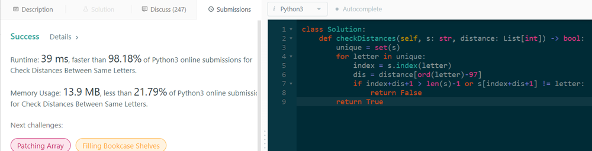

# Python | 98% Faster |  Easy Solution✅

**Author:** gmanayath
**Votes:** 8
**Link:** [https://leetcode.com/problems/check-distances-between-same-letters/solutions/2544726/](https://leetcode.com/problems/check-distances-between-same-letters/solutions/2544726/)

---

```
def checkDistances(self, s: str, distance: List[int]) -> bool:
        unique = set(s)
        for letter in unique:
            index = s.index(letter) # get the first index of the letter
            dis = distance[ord(letter)-97]
            if index+dis+1 > len(s)-1 or s[index+dis+1] != letter:
                return False
        return True
```

