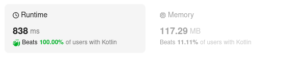

# Kotlin. Beats 100% (838 ms). PriorityQueue + custom comparator.

**Author:** mobdev778
**Votes:** 3
**Link:** [https://leetcode.com/problems/meeting-rooms-iii/solutions/4747376/](https://leetcode.com/problems/meeting-rooms-iii/solutions/4747376/)

---



# Code
```
class Solution {
    fun mostBooked(n: Int, meetings: Array<IntArray>): Int {
        meetings.sortWith(IntervalComparator)

        val roomPQ = PriorityQueue(n, RoomComparator)
        for (i in 0 until n) {
            roomPQ.add(Room(i, 0, 0))
        }
        for (meeting in meetings) {
            val start = meeting[0].toLong()
            while (roomPQ.peek().openTime < start) {
                val opened = roomPQ.poll()
                opened.openTime = start
                roomPQ.offer(opened)
            }

            val room = roomPQ.poll()
            room.meetings++
            room.openTime += meeting[1] - start
            roomPQ.offer(room)
        }

        var result = roomPQ.poll()
        while (roomPQ.size > 0) {
            val room = roomPQ.poll()
            if (result.meetings < room.meetings || result.meetings == room.meetings && result.number > room.number) {
                result = room
            }
        }
        return result.number
    }

    object IntervalComparator: Comparator<IntArray> {
        override fun compare(a: IntArray, b: IntArray): Int = a[0] - b[0]
    }

    // we need to use "Long" for openTime to pass Testcase #81
    class Room(val number: Int, var meetings: Int, var openTime: Long) {
        override fun toString(): String = "Room($number, meetings: $meetings, openTime: $openTime)"
    }

    object RoomComparator: Comparator<Room> {
        override fun compare(a: Room, b: Room): Int {
            val openDiff = a.openTime.compareTo(b.openTime)
            if (openDiff != 0) return openDiff
            return a.number - b.number
        }
    }
}
```